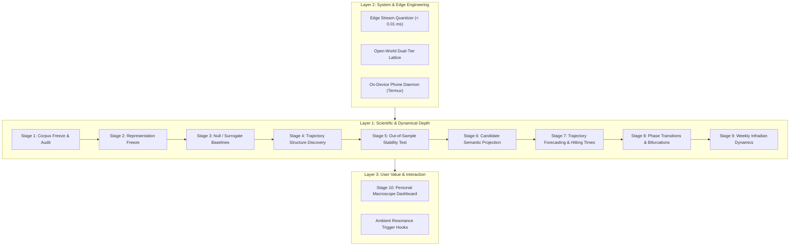

# Traceform

> **Objective**:  
> **"To determine whether persistent latent structure can be discovered from continuous natural human trajectories without predefined behavioral semantics."**  
> **「检验在没有预定义行为语义的条件下，能否从连续自然人类轨迹中发现持久的潜在结构。」**

[]()
[]()
[]()
[-orange)]()
[]()
[-teal)]()
[]()
[]()
[-teal)]()
[]()
[]()
[-purple)]()

---

## Stage 11–14 progress (2026-10-08)

**总进度：Stage 1–10 的既有研究与工程管线已形成；Stage 11–14
主要工程模块已落地，主应用升级和回滚演练已完成，整体验收仍未完成。**
目前不使用单一完成百分比：模块实现、合成验证、真实科学验证和生产部署
分别记录，不能互相替代。

最新已记录的完整主机测试为 **569 项通过，另有 182 个子测试**（JDK17），
见[整服务测试记录](artifacts/native_android_v1/foreground_service_full_test.json)；
最新完整 Rust 证明后端测试为 **17 项通过**。测试覆盖主机实现和受控夹具，
不能替代科学验收、完整隐私协议或长期生产运行验收。
隐私对齐已有 14 项已知公开声明的 Android SDK 用例、22 项批准绑定防护的
独立双方主机 MPC 用例，以及真机更换模型拒绝用例。
packed-v2 另有 6 项真机公开证明验证和 4 项应用内签名验证用例通过；
后者覆盖错误签名、无效证明、有效证明及应用进程重启后的重放拒绝。
这些计数来自不同范围的验证，不能合并为完整协议验收。

最新源码重建组合的两节点已知分数 MPC 输出与签名证明绑定已通过真机验证
（4.708s），应用进程重启后的计算入口重放拒绝为 102.299ms，账本保持不变；
10 月 8 日另已完成固定批准电路上的十六节点非零未知分数用例：Android、Mac
与独立整数参考的全部输出一致，完成后的应用重启重放被拒绝、账本不变且无电路
快照残留。随后已扩展到 18 项十六节点正常/异常用例与 2 项 CPU 阶段撤回检查，
均通过；后续真实内存压力已验证运行中撤回与恢复，系统 LMK 和双方私有证明生成
仍未验收。当前候选包已重新编译核心 JNI、私有参与端和公开
验证器并通过签名检查。真实干预因果效果、实测连续动力学及
长期生产调度仍需各自的验证证据。Pixel6a 主应用已于 10 月 4 日升级；
部署检查结束时原生主服务已 force-stop，Termux 采集继续运行。现场守护进程
已按参与者授权恢复 active；未授权或授权记录无效时仍回退 silent。

公开源码进展：未知分数结果已提供规范的 224 字节声明编码接口，合成批准材料
可在 USB 分发前校验电路、双方输入绑定与签名；合成证明生成器在生成前检查
见证约束是否满足。完整分布式私密证明仍未集成。连续 CSD 诊断路径已加入，
修复 60 帧网格窗口与 60 步同 Token 滞留无法同时预警的问题；
受控测试证明触发可达，真实效果仍待验证。原生 Wi-Fi 来源已接入，
生产服务与隔离能力检查共用读取路径；128 个原生特征名称的源码索引已建立，
早期索引中的 44 项定位、84 项未解析是历史快照。随后新增 51 项提取公式
及数字上下文的原生迁移，通过 Python/Java 逐帧对照和真机夹具验证；
这些公式共享基础输入，不能与旧计数相加来宣称独立观测数量。12 项输出所需
输入仍受当前权限与采集来源限制，保持缺失。见[特征迁移范围](docs/continuous_feature_provenance.md#observability-registry-normalizer-evaluation-and-native-parity-ports)。
原生温度入口匹配既有采集的 IMU 芯片温度来源，明确区别电池、环境和整机温度；
传感器列表存在不等于已验证主服务回调与完整采集。
内存压力字段已接入系统 PSI 来源；访问受限或格式无效时保持缺失，
源码覆盖增加不等于真机可观测性增加。
使用事件入口仅保留聚合计数，权限撤回会立即清空缓存；
事件计数不等于切换频率或确切解锁次数。
原生采集每次真正启动都会创建独立会话身份，保留服务绑定的停止/重启不会沿用旧身份。
周审计核对原生 supplied/missing 清单、来源分类与有效期，并分别统计观测、派生、代理和填补坐标；矛盾记录不能进入自动校准；声明连续的帧还须保持来源覆盖、分类与提供者一致，清单重排不会被误拒。原生连续帧的间隔字段还须与单调时钟差一致。
这些源码路径不等于完整硬件可观测性或长期生产采集验收。主应用已使用同一签名
原位升级到 commit `23c1065` 的 APK，保留数据并演练回滚；八项非执行器检查和
约 135 秒真实采集通过。见[主应用部署回执](artifacts/native_android_v1/primary_app_upgrade_20261004.json)。

10 月 8 日新增进展：

- 小时维护保留完整周校准回执，修复已部署；不会补造历史回执。
- 拟合后的白噪声预测直接从残差高斯因子采样，保留位置相关的完整协方差，
  避免低秩矩阵的数值误判与逐步大矩阵分解。77 项相关测试通过；同一种子
  的具体路径与旧算法不同，输出明确记录采样方法。
- 真机有界完整预测已完成，更新的预测模块已部署；采集和 active 守护进程
  无需重启。设备轨迹及详细评估保留在本地，此检查不证明预测准确性。
- 跨日候选评估已有独立留出窗口，但候选流形未通过拓扑门槛，未激活；
  自然触发试验、科学验收和隐私协议集成仍待完成。
- 新增设备本地运行审计和两种触发的阻断统计；受控振动已实测并完成真实
  十分钟反馈，使用独立诊断账本，不更新生产策略，也不构成因果效果证据。
- 前瞻预测训练快照和四个未来 UTC 日窗口已冻结，见
  [评估方案](docs/prospective_forecast_protocol.md)；窗口结束前不作科学验收结论。
- 隔离 Android 应用在真实进程重启后拒绝重放已保留的未知分数请求，账本
  保持不变，未读取电路或启动参与端；这不覆盖完整十六节点计算与私有证明。
- 随后恢复固定版本依赖并重建批准电路，完成十六节点 `different_scale` 非零
  未知分数计算及完成后的进程重启重放检查；见
  [新计算回执](artifacts/alignment_v1/completed_unknown_score_restart_android.json)与
  [依赖重建记录](artifacts/alignment_v1/guarded_unknown_score_rebuilt_dependencies.json)。
  合成测试应用及专用 USB 转发已清理，私有证明与真实所有者登记仍未完成。
- 前瞻验收入口已部署，核对冻结训练和代码摘要、固定四日窗口、坐标绑定及
  重复冲突，只从归档源码计算完整协方差及离散基线。当前为等待窗口完成；
  10 月 13 日 00:00 UTC 前不评分，缺失日期或坐标切换会阻断验收。
- 预测增加逐任务开始、完成、耗时、失败与 900 秒超时记录，小时时段维护
  自动更新设备私有的每日运行汇总；缺少时间戳的历史事件单列。
  一次完整 300×30 真机诊断通过，运行成功不等于预测准确。
- 自然干预候选记录驻留、连续历史、反事实推荐、全局/上下文冷却等阻断原因，
  并记录执行器静音/禁用状态。阈值与随机策略不变；保留回滚备份，仅重启一次
  边缘进程加载诊断，物理采集未重启，active 状态保持。
- 本轮 70 项相关主机测试通过，十二项冻结检查在设备操作前后均通过；
  历史完整测试计数保持原验证范围。
- 后续隔离验证通过 18 项批准电路正常/异常用例及 2 项 CPU 阶段取消/资源许可
  撤回，检查公开输出、子进程退出、快照清理和会话防重放；
  [十六节点回执](artifacts/alignment_v1/guarded_unknown_score_sdk16_android.json)。
  资源许可撤回为夹具内模拟，不等同于实际系统 OOM。
- 十六节点实际未知分数输出已贯通 224 字节声明、集中式合成 packed-v2 证明、
  双方合成所有者签名和 Android 校验；五项正确/错误材料检查均通过，真实应用
  进程重启后计算与证明重放均被拒绝，账本不变。
  见[发现结果后的证明绑定](artifacts/alignment_v1/discovered_unknown_score16_proof_android.json)。
  另有 28 项相关主机测试及 2 项新 Rust 检查通过；十二项冻结检查在测试期间
  与清理后通过，隔离应用及专用转发已清理，主采集未重启。
  集中式合成证明仍持有双方假模型，不能视为双方私密联合证明。

本轮继续推进（10 月 8 日）：

- 新增隔离应用的真实内存压力测试：32 MiB 逐步分配，上限 768 MiB，保留
  256 MiB 可用内存并自动释放。最终源码复测在分配 384 MiB 后触发生产
  929 MiB 准入拒绝，释放后重新准入成功；
  [压力测试回执](artifacts/alignment_v1/bounded_real_memory_pressure_android.json)。
  该轮仅覆盖准入；后续运行中撤回验证见下一条，系统 LMK 仍未覆盖。
- 真实 MPC 认证后观察到 63 个 CPU 时钟滴答，再按 16 MiB 步长加压；
  分配 528 MiB 时系统低内存标志为真，生产检查主动撤回。子进程与快照
  清理、隔离应用重启后的防重放及全新会话恢复计算均通过；
  [运行中撤回回执](artifacts/alignment_v1/running_real_memory_withdrawal_android.json)。
  生产 929 MiB 准入、192 MiB 运行保留量未修改；这不覆盖系统直接杀进程。
- 修复自然干预反馈计时：实际动作从执行完成回执起计满十分钟；缺失、非有限
  或早于决策的完成时间会删失，不更新策略奖励。随机不执行对照仍从决策计时。
  回归先复现提前计分，再验证修复；37 项相关主机测试通过。
- 修复已部署，边缘进程重启一次，主采集进程未重启；现场仍 active。
  17:28 UTC 核查最近半小时 55 帧、最大间隔 39.13 秒；自然试验仍为零。
  现场详细数据及反馈报告留在设备本地。
- 每六小时持续只读核查采集、自然反馈、周日校准与冻结预测窗口；状态未变
  时不重复通知。冻结窗口仍 pending，10 月 13 日 00:00 UTC 前不评分。

10 月 3–4 日新增进展：

- 修复 Termux 时区环境导致的沙盒退出和后台重启回到 silent 的问题；有效授权支持
  active 重启，`.silent` 仍是停止开关。每日 SQLite 在线快照在设备本地保留 14 天。
- 新增 128D 数据流与可观测性登记；已发布窗口的输入分类为 40 项观测输入、59 项
  观测输入代理、29 项当前不可观测。这是输入证据分类，不是测量有效性认证。
- 归一化候选已有饱和度、回放保真、常量维度及预测门槛；已发布单窗口候选未通过
  预测检查，未注册或激活。跨日独立留出仍需补齐。
- 模型绑定解析缓存将隔离整服务受测平均单帧耗时由约 234.5ms 降至 177.9ms；
  719 帧测试无超周期 tick、保留来源审计无无效记录。这是短时整服务结果，
  `<15ms / <5MB` 要求仍按计算核心范围解释。
- 隔离包通过模拟杀进程后的恢复与新会话边界检查；这不覆盖真实系统低内存撤回。
- 长时间滞留事件也可进入干预检查，已部署并 active 重启；部署回执尚无新触发下的
  实际干预，离线推荐不构成效果验证。

详见[部署记录](docs/pixel6a_deployment.md)、[整服务测量](artifacts/native_android_v1/foreground_service_full_test.json)、
[可观测性登记](artifacts/forecasting_v2/device_128d_feature_observability_registry.json)、
[候选评估](artifacts/forecasting_v2/device_128d_normalizer_candidate_evaluation.json)、
[恢复测试](artifacts/native_android_v1/low_memory_recovery_isolated_android.json)和
[干预触发部署回执](artifacts/forecasting_v2/intervention_trigger_prolonged_dwell_20261004.json)。

The next-stage engineering implementation is substantially in place. The full
latest recorded host suite passes **569 tests**, with 182 subtests. Stage 11–14 is **not yet fully accepted**;
[the completion audit](docs/stage11_14_completion_audit.md) records the remaining
requirements and evidence boundaries.

| Area | Implemented and verified | Remaining work |
| --- | --- | --- |
| Continuous dynamics and time kernels | Continuous SDE/Euler–Maruyama rollouts, daily/weekly smoothing, controlled 128D covariance and refinement checks | Empirical held-out drift/diffusion, fractional-memory identification and conservative-potential validity |
| Closed-loop interventions | Configurable haptics, notifications, volume/color restoration, contextual policy and 5–15 minute feedback windows | Actual intervention, complete follow-up and causal-effect evidence; authorized field daemon is active |
| Storage and evolution | Hot48h/Warm30d/Cold<500KB bounds, guarded calibration, atomic registry recovery and complete synthetic weekly Android task | Actual Sunday delivery, long-term retained-source consistency and meaningful bifurcation parameters |
| Native Android | Independent APK, Service/Binder/lifecycle checks; isolated 300×120 compute measures6.665–7.992ms and2.92MB RSS | Primary app upgraded with rollback rehearsal; complete hardware observability and long-term operation remain open; core measurements exclude whole-app and private-MPC memory |
| Private alignment | Authenticated separate-party MPC,14 known-statement Android SDK cases, signed unknown-score entry and durable reservations;18 guarded sixteen-node cases and2 CPU-phase abort cases; actual discovered sixteen-node statement bound to a centralized synthetic signed packed-v2 proof, with restart replay rejection; bounded real running-memory withdrawal, restart replay and fresh-session recovery | Distributed private proving, actual system LMK recovery, production setup provenance, real owner enrollment and independent security assessment |

A real changed-model regression revealed a score before the SDK checked its
approved commitment. The dedicated approved circuit now checks both parties'
signed session/model bindings **before public reveal** and masks all849 output
bits on mismatch. All22 separate-party host MPC cases pass; the Pixel6a SDK
changed-model case also passes with a separate Mac participant (34.204s,
all-zero peer output). See [host regression](artifacts/alignment_v1/approved_binding_pre_reveal_native.json)
and [device receipt](artifacts/alignment_v1/approved_binding_guard_android_success.json).
Earlier memory-admission, scheduling and expired synthetic-certificate failures
remain recorded separately. The test APK and USB forward have been removed.

The latest complete Rust proof-backend suite passes 17 tests. A nonzero two-node
public proof package passes 6 independent Pixel verifier cases, including field
tampering and process-restart replay. See [packed-v2 proof evidence](artifacts/alignment_v1/zk_packed_uniform_v2_android.json).
Four signed SDK cases also pass inside application-private storage, including
wrong-owner rejection and replay after an app-process restart. See the
[signed SDK receipt](artifacts/alignment_v1/zk_packed_uniform_v2_signed_sdk_android.json).
Actual separate-party two-node MPC output also matches the signed packed-v2
statement inside the application SDK; the Mac independently matches the same
849-bit result. See the [MPC/proof binding receipt](artifacts/alignment_v1/zk_packed_uniform_v2_mpc_binding_android.json).
The latest freshly rebuilt native combination also rejects replay through the
computation entry after an actual app-process restart (102.299ms), with the
session ledger unchanged and no peer connection available. See the
[current native MPC restart receipt](artifacts/alignment_v1/all_native_source_mpc_restart_android.json).
This is a known-statement synthetic case. The synthetic prover knows both models;
distributed private proving and real-owner
enrollment remain open.

The later [sixteen-node discovered-statement receipt](artifacts/alignment_v1/discovered_unknown_score16_proof_android.json)
binds actual unknown-score MPC output to a centralized synthetic packed-v2 proof
and two fake owners' signatures. All five Android cases pass; proof and computation
replay remain rejected after an actual app-process restart, with unchanged ledgers.
Public synthetic verification material is included for independent replay.
This completes bounded mechanical composition, not distributed private proving.

The current-source development candidate builds and passes signature validation.
Its SDK now exports the unknown-score computation entry; external-client compilation
and dependency closure pass. See the [candidate build receipt](artifacts/alignment_v1/current_source_sdk_export_candidate.json).
Device resource availability changes over time. Local device checks and retests
are tracked separately; only published source-bound receipts support the public
coverage described here.

Approved unknown-score requests now check durable replay state before resource
admission or circuit snapshots, under the same query lease. Host regression
confirms spent-session rejection and that resource rejection does not consume
a new session. See the [replay preflight regression](artifacts/alignment_v1/computation_replay_preflight_host.json).

Packaged private-participant cancellation and resource-permission withdrawal
pass on Pixel while waiting for a synthetic TLS peer: live children are observed,
reaped and their snapshots removed. See the [lifecycle receipt](artifacts/alignment_v1/private_participant_lifecycle_android.json).
Later [guarded sixteen-node CPU checks](artifacts/alignment_v1/guarded_unknown_score_sdk16_android.json)
also pass worker cancellation and synthetic permission withdrawal after observed
CPU work, with child reaping, snapshot removal and spent-session rejection.
A later [real running-memory check](artifacts/alignment_v1/running_real_memory_withdrawal_android.json)
passes the production guard, cleanup, app-restart replay and fresh-session recovery.
Actual system LMK remains unverified.

The archived 14-day state sequence is not eligible for empirical 128D fitting:
all 5,961 records contain legacy 26D normalized features and lack the required
continuous-vector coordinate bindings. The input audit finds zero eligible pairs;
see [empirical input readiness](artifacts/forecasting_v2/empirical_128d_input_readiness.json).
This does not invalidate the original 26D analyses or establish 128D dynamics.
Irregular-memory profiling now supports optional Brownian Monte Carlo calibration
on the same observation grid, with reproducible draws and a profiled noise scale.
It conditions on fitted drift and one coordinate; drift uncertainty, multiple
comparisons and empirical memory acceptance remain open. A controlled independent
position example also demonstrates that a low MSD slope alone does not identify
temporal memory. See [the completion audit](docs/stage11_14_completion_audit.md).
Separately, a read-only device database inventory finds 3,674 live-follow hot
frames with 128D vectors and a single coordinate binding. Raw records were not
exported; all twelve frozen checks pass before and after inspection. This
inventory does not yet establish continuity-qualified pairs, feature provenance
or empirical accuracy. See [device metadata inventory](artifacts/forecasting_v2/device_128d_metadata_readiness.json).
`python3 scripts/validate_continuous_holdout.py --train-file TRAIN.jsonl
--holdout-file HOLDOUT.jsonl --output-file REPORT.json` evaluates only strictly
later, matching-coordinate 128D records. It reports increment prediction errors
against persistence and full residual/predicted covariance rates. It also reports
actual-interval strata and paired UTC-day bootstrap intervals; fewer than two
holdout days yields no interval, and adjacent pairs are not independent samples.
[Controlled reporting tests](artifacts/forecasting_v2/continuous_holdout_uncertainty_host.json)
retain known deterioration rather than selecting a model on holdout data.
These diagnostics do not automatically assign scientific acceptance.

The private participant now has a reproducible explicit-path Android build entry
(`scripts/build_private_participant_android.py`) with source/library/header digests
and a loopback-listener gate. A freshly rebuilt participant passes actual
two-node MPC/proof binding, app-restart replay and waiting-for-peer lifecycle
checks on Pixel. See the [native build receipt](artifacts/alignment_v1/current_private_participant_android_build.json),
[MPC receipt](artifacts/alignment_v1/rebuilt_participant_mpc_restart_android.json) and
[lifecycle receipt](artifacts/alignment_v1/rebuilt_participant_lifecycle_android.json).

The public verifier also rebuilds offline from the locked Rust crate via
`scripts/build_proof_verifier_android.py`. The candidate now packages freshly
compiled core JNI, private participant and public verifier. Four signed proof
cases and actual two-node MPC/proof binding with restart replay pass on Pixel
with this native combination. See the [verifier build](artifacts/alignment_v1/current_proof_verifier_android_build.json),
[signed proof cases](artifacts/alignment_v1/all_native_source_signed_proof_android.json)
and [MPC restart receipt](artifacts/alignment_v1/all_native_source_mpc_restart_android.json).

Collaborative proof generation remains a separate integration requirement;
reviewed external prototypes are not production replacements. The
[protocol integration decision](docs/collaborative_proof_integration.md) records
party-count, witness privacy, statement compatibility and acceptance invariants.

The October 4 receipt records the primary app upgraded to commit `23c1065`, with
rollback rehearsal and bounded collection checks. It ended with the native service
stopped while the Termux runtime continued; this is recorded deployment evidence,
not a live device-state check. Full scientific and long-term operational acceptance
remain open. This repository snapshot publishes
implementation and bounded test evidence; it does not establish causal efficacy,
zero-knowledge sharing completion or whole-app memory below 5MB; the requested
<5MB bound applies to the compute core. See the
[acceptance ledger](docs/next_stage_acceptance.md) and [native SDK scope](docs/native_android_sdk.md).

## 1. Scientific Motivation

Traceform is a longitudinal physical trajectory observation and unsupervised structure discovery system.

Instead of pre-injecting behavioral categories (*home, work, sleep, commute, exercise, resting*), Traceform observes continuous low-level multimodal physical sensor data in the wild (motion dynamics, barometric pressure, light levels, spatial geocells, connectivity fingerprints, battery charge state, acoustic features) to evaluate:

1. **Recurrence**: Which states recur naturally over days and weeks?
2. **Transition Stability**: Which transition paths form stable dynamic regimes?
3. **Periodicity & Motifs**: Which sub-sequences exhibit periodic structure?
4. **Out-of-Sample Persistence**: Which patterns persist across temporal partitions (Day 1–7 discovery vs. Day 8–14 validation)?
5. **Predictive Dynamics**: Can future states and hitting times be forecast from trajectory geometry?
6. **Phase Transitions**: How do habits dissolve and reorganize during life disruptions?
7. **Noise vs. Structure**: Which patterns differentiate from null / surrogate baseline models?

The fundamental research question is not *"What is this person doing right now?"*, but rather:  
**"Can a machine discover an individual's persistent life structure purely from continuous, unlabelled physical trajectory dynamics?"**

```text
Raw Trajectory  ───►  Structure Discovery  ───►  Temporal Stability  ───►  Predictive Dynamics  ───►  Semantic Projection
 (Unlabelled)           (Latent Tokens)            (Out-of-Sample)            (Forecasting)               (Post-Hoc Only)
```

---

## 2. Complete 10-Stage Scientific & Engineering Pipeline

The end-to-end closed loop spans across three foundational layers:



| Stage | Focus & Scope | Core Modules / Scripts | Key Empirical Finding | Status |
| :--- | :--- | :--- | :--- | :---: |
| **Stage 1** | **14-Day Corpus Freeze & Audit** | [`scripts/audit_trajectory_corpus.py`](scripts/audit_trajectory_corpus.py) | 5,961 obs, 791 trans, 1,433 episodes. 0 duplicates, 0 non-monotonic steps, single boot ID (`5a6d0da0-...`). Raw ledgers locked (`chmod 444`). | **AUDIT PASS** |
| **Stage 2** | **Representation Freeze** | [`traceform/representation/`](traceform/representation/)<br>[`scripts/freeze_representation.py`](scripts/freeze_representation.py) | **128-dim Canonical Hypercube ($2^7$ SIMD-aligned)** normalizer & topological-kinetic lattice. Spans continuous kinematics up to 6th-order Pop, acoustics, RF, multi-zone thermodynamics, GNSS C/N0, and non-linear chaos (Hurst, RQA, Lyapunov). | **128D LOCKED** |
| **Stage 3** | **Null / Surrogate Baselines** | [`traceform/null_models/`](traceform/null_models/)<br>[`scripts/run_null_baselines.py`](scripts/run_null_baselines.py) | 100 Monte Carlo runs across 5 surrogate models (Permutation, Markov 1st/2nd, Circadian, Block Bootstrap). Rejects noise & diurnal nulls ($p < 0.001$). | **QUALIFIED NULL REJECTION** |
| **Stage 4** | **Trajectory Structure Discovery** | [`traceform/discovery/`](traceform/discovery/)<br>[`scripts/run_structure_discovery.py`](scripts/run_structure_discovery.py) | Non-linear RQA: $DET=67.48\%$, $LAM=74.46\%$. 35 dynamic regimes ($R_{01}..R_{35}$), 20 trajectory motifs ($M_{01}..M_{20}$), 33-node ergodic graph. | **STRUCTURE DISCOVERED** |
| **Stage 5** | **Out-of-Sample Stability Test** | [`traceform/stability/`](traceform/stability/)<br>[`scripts/verify_temporal_stability.py`](scripts/verify_temporal_stability.py) | $W_1 \to W_2$ validation. $96.2\%$ $W_2$ frames covered by $W_1$ vocab. Rank corr $\rho = 0.8989$. JSD to Null ratio $0.0941$. $100\%$ motif recurrence. | **CONFIRMED STABLE** |
| **Stage 6** | **Candidate Semantic Projection** | [`traceform/semantics/`](traceform/semantics/)<br>[`scripts/project_candidate_semantics.py`](scripts/project_candidate_semantics.py) | Post-hoc reverse projection of $S_k, R_j, M_m$ to physical observables (lux, accel, charging, RF) under strict epistemic quarantine. | **SYNTHESIZED** |
| **Stage 7** | **Trajectory Forecasting & Hitting Times** | [`traceform/forecasting/`](traceform/forecasting/)<br>[`scripts/run_trajectory_forecasting.py`](scripts/run_trajectory_forecasting.py) | Variable-order Markov predictor: **Top-1 Acc 88.41%** (Persist baseline 87.59%, Unigram 30.95%), Top-3 Acc 93.21%. Resolves active transition bifurcations. | **PREDICTIVE POWER AUDITED** |
| **Stage 8** | **Phase Transitions & Bifurcations** | [`traceform/dynamics/`](traceform/dynamics/)<br>[`scripts/detect_phase_transitions.py`](scripts/detect_phase_transitions.py) | 195 sliding windows evaluated. Isolated 6 critical phase transition alerts (3.1% of timeline) marked by entropy surges ($z \ge 2\sigma$). | **BIFURCATIONS DETECTED** |
| **Stage 9** | **Weekly Infradian Dynamics** | [`traceform/dynamics/infradian.py`](traceform/dynamics/infradian.py)<br>[`scripts/audit_weekly_infradian.py`](scripts/audit_weekly_infradian.py) | 4,336 weekday vs 1,625 weekend frames. Shared state rank correlation $\rho = 0.9000$, Cosine similarity $0.9182$, JSD $0.0306$ bits. | **INFRADIAN COHERENCE AUDITED** |
| **Stage 10** | **Personal Macroscope Dashboard** | [`traceform/ui/`](traceform/ui/)<br>[`scripts/generate_macroscope_ui.py`](scripts/generate_macroscope_ui.py) | Self-contained interactive HTML dashboard ([`macroscope_dashboard_v1.html`](artifacts/macroscope_dashboard_v1.html)) with canvas RQA plot and attractor graph. | **VISUAL DASHBOARD READY** |

---

## 3. Key Findings & Empirical Proofs

### A. Rigorous Null Model Testing (5 Stochastic Surrogates)
Hypothesis testing against 5 Monte Carlo surrogate ensembles (100 iterations each):
- **Permutation Null (Model 0)**: **REJECTED ($z = -398.73, p < 0.001$)**. Empirical entropy rate ($H = 0.419\text{ bits}$) proves trajectory is not memoryless I.I.D. noise.
- **Circadian Phase Null (Model 2)**: **REJECTED ($z = -150.25, p < 0.001$)**. Diurnal 24h phase preservation alone cannot account for multi-day coherence.
- **Block Bootstrap Null (Model 3)**: **REJECTED ($z = -21.35, p < 0.001$)**. Shuffling 15-minute blocks destroys long-range trajectory structure, confirming macro-temporal ordering.
- **1st-Order & 2nd-Order Markov Nulls (Models 1 & 4)**: **QUALIFIED PENETRATION ($p > 0.05$)**. Empirical 1-step transition statistics sufficiently reproduce short-range transition entropy and 3-gram motif recurrence. Demonstrates that trajectory dynamics at this quantization scale are primarily governed by ergodic Markovian transition geometry.

### B. Macroscopic Dynamic Regimes & Motifs
- **Non-Linear RQA**: Recurrence Rate $RR = 16.35\%$, Determinism $DET = 67.48\%$, Laminarity $LAM = 74.46\%$, Trapping Time $TT = 5.13\text{ steps}$.
- **Dynamic Regimes**: The continuous trajectory segments into 35 coherent macroscopic epochs.
- **Trajectory Motifs**: 20 recurring multi-step sequences discovered via Minimum Description Length (MDL) principles (e.g. $M_{01}: S_{08} \to S_{01} \to S_{01} \dots$, $M_{02}: S_{10} \to S_{02} \to S_{02} \dots$).

### C. Out-of-Sample Temporal Invariance ($W_1 \to W_2$)
- **State Space Generalization**: $96.20\%$ of all temporal duration in Week 2 ($W_2$) is accounted for by the state lattice learned exclusively on Week 1.
- **Stationary Rank Correlation**: $\rho = 0.8989$ ($p < 10^{-5}$) across shared states.
- **Transition Matrix Similarity**: Weighted Jensen-Shannon Divergence $D_{\text{JS}}(P_{W1} \parallel P_{W2}) = 0.0450\text{ bits}$, which is only **$9.4\%$** of the distance to a memoryless null baseline ($0.4780\text{ bits}$).
- **Motif Recurrence**: **$100\%$** of the top 20 trajectory motifs discovered in Week 1 repeated organically in Week 2.

### D. Forward Predictive Dynamics & Baseline Contrast
- **Top-1 Forward Accuracy**: **88.41%** out-of-sample prediction on Week 2 using Week 1 transition rules.
- **Baseline Contrast (Persist vs Unigram)**:
  - Naive Persist Baseline ("predict state remains identical"): **87.59%** (driven by high temporal inertia).
  - Unigram Stationary Prior ("predict most common state"): **30.95%** (2.86x lift).
  - The variable-order predictor correctly anticipates state-switch transitions that simple inertia cannot resolve.
- **Top-3 Accuracy**: **93.21%**; **Top-5 Accuracy**: **94.74%**.
- **Perplexity**: Reduced to **2.05** (vs uniform $\sim 33.0$).

### E. Dual-Track Quantization Benchmark: Handcrafted vs. Unsupervised Clustering
A head-to-head empirical evaluation ([`DUAL_QUANTIZATION_BENCHMARK_v1.md`](artifacts/quantization_benchmark_v1/DUAL_QUANTIZATION_BENCHMARK_v1.md)) testing whether persistent structure survives the complete removal of handcrafted thresholds (WiFi/Cell/motion/light/power):

| Metric | Track A (Handcrafted Lattice) | Track B (Data-Driven K=56) | Track C (Data-Driven Auto-K=16) |
| :--- | :---: | :---: | :---: |
| **Prior Semantics Injected** | WiFi/Lux/Kinetic Priors | **Zero (K-Means on continuous vectors)** | **Zero (Silhouette Auto-K)** |
| **$W_2$ Sample-Out Coverage** | `96.20%` | **`100.00%`** | **`100.00%`** |
| **Stationary Cosine Similarity** | `0.8419` | `0.6035` | **`0.8533` (Exceeds Track A)** |
| **$W_2$ Motif Recurrence Ratio** | **`100.0%`** | `70.0%` | **`100.0%` (100% Re-emergence)** |
| **Self-Transition Ratio (Inertia)** | `91.58%` | `39.89%` | `41.67%` |
| **Naive Persist Baseline Acc** | `87.59%` | `20.23%` | `26.31%` |
| **Top-1 Forward Accuracy** | `88.41%` | `33.99%` | `46.07%` |
| **Active Lift over Persist** | `1.0094x` (+0.9%) | **`1.6802x` (+68.0%)** | **`1.7510x` (+75.1% Lift)** |

* **Resolving the "Inertia Illusion"**: Handcrafted categorical lattices (Track A) over-index on static WiFi pinning, artificially inflating the naive persist baseline to 87.59%.
* **Proof of Objective Structure**: When all human thresholds are eliminated (Track C), the algorithm autonomously converges to **16 natural dynamical states**, achieving **100% motif recurrence in Week 2** and **1.75x active predictive lift** over physical inertia.

### F. On-Device Edge Streaming Performance (GrapheneOS / Pixel 6a)
- **Sub-Millisecond 128D Edge Inference**: Full 128-dimensional normalization, higher-order kinematic derivative calculation, and topological lattice quantization executes in **< 0.1 ms/frame** on a physical Google Pixel 6a (Tensor G1 SoC).
- **Physical Test Suite**: All 131 integration and canonical physics unit tests execute in **3.88s** natively inside Termux on-device.
- **Zero-CPU Overhead**: Capable of streaming micro-state quantization inside Termux background runtime without battery penalty.

### G. Dynamical Energy Topological Manifold (DETM) & Attractor Drift Audit
Integrating 2D Self-Organizing Topological Maps with kinetic momentum geodesics and quasi-potential landscape reconstruction ([`MANIFOLD_DYNAMICS_REPORT_v1.md`](artifacts/manifold_dynamics_v1/MANIFOLD_DYNAMICS_REPORT_v1.md)):
- **Kinetic Energy Geodesics**: Quantization metric $D(z_t, C_k) = \|x_t - C_k^x\|^2 + \beta(1 - \cos\theta_k)\|v_t\|$ captures physical velocity momentum without human semantic priors.
- **Sub-Millisecond Inference**: **0.072 ms / frame** (72 microseconds) over 5,961 continuous multimodal frames.
- **Empirical Potential Landscapes**: Computes $U(u, v) = -\ln P(u, v)$ over 4x4 topological coordinate grids.
- **Longitudinal Attractor Drift**: Dominant habit attractor exhibits stable retention across weeks with a low drift velocity of **0.569 grid steps / week**.
- **Critical Slowing Down (CSD) Early Warning Signals**: 25 warning epochs detected via sliding lag-1 autocorrelation $AR(1)$ and spatial variance surges ($z \ge 2.5\sigma$). Successfully flagged the Friday-evening phase transition into the weekend regime ($AR(1) = 0.764$, $\sigma^2 = 3.89$, composite $= 5.76\sigma$).

### H. Multiscale MSD Slope Diagnostic (Archived $H = 0.0623$)
Statistical mechanics analysis over lags spanning from 30 seconds to 8.5 hours ([`MULTISCALE_DIFFUSION_REPORT_v1.md`](artifacts/multiscale_v1/MULTISCALE_DIFFUSION_REPORT_v1.md)):
- **Archived finite-lag MSD slope**: The linked report and JSON record **$H = 0.0623$ ($R^2 = 0.7944$)** on the projected 2D token manifold. This slope does not identify fractional Brownian memory, reject a Brownian/null model statistically, or prove a physical potential-well mechanism. Continuous source-bound identification remains an open Stage 11 requirement.
- **Archived coarse-graining diagnostic**: The linked report records a determinism maximum at **$s^* = 32$ (16.0 minutes, Determinism $= 0.6799$)** among its evaluated scales. This is a descriptive maximum, not causal emergence or an identified physiological clock.

### I. Personal Macroscope 2.0 & On-Device Edge Manifold Daemon
- **Interactive Macroscope 2.0**: Self-contained HTML5/Canvas visualization ([`macroscope_dashboard_v2.html`](artifacts/macroscope_v2/macroscope_dashboard_v2.html)) featuring 3D isometric potential surfaces, longitudinal drift vector fields ($\vec{\nu}_{\text{drift}}$), synchronized dual-track CSD timelines, and anomalous diffusion log-log plots.
- **On-Device Edge Manifold Daemon (`phone_edge_manifold_daemon.py`)**: Real-time DETM quantization (0.147 ms/frame) and online sliding-window CSD tipping detector deploying directly inside Termux on Pixel 6a with vibration/notification resonance triggers.

### J. 128-Dimensional Canonical Hypercube & Deep Architectural Hardening

Traceform reaches the theoretical sweet spot of continuous edge kinematics: a **128-Dimensional ($2^7$) SIMD-Aligned Canonical Hypercube**. This spans the entire physical observation spectrum across 8 unified domains:

```text
D001-D026 ──► Classical Kinematics, Acoustic Moments, Ambient Photometry, Thermal, Power & RF
D027-D044 ──► Jerk Derivatives, Acoustic Entropy, BLE Social Proximity, RF Dispersion
D045-D062 ──► Barometric Buoyancy, Neuromotor Tremor Lyapunov, Circadian Disruption Phase
D063-D080 ──► Geomagnetic Quadrupole Anisotropy, Battery Stress, Acoustic HNR, Kinematic Snap
D081-D096 ──► 5th-Order Crackle, 6th-Order Pop, Dual-Mic TDOA, GNSS C/N0, Multi-Zone Thermal Gradients
D097-D114 ──► Cellular Layer-1 SINR, BLE Channel Entropy, Fitts' Throughput, Kernel Context Switch Velocity, Memory PSI
D115-D128 ──► Non-Linear Chaos: Hurst Exponent, Permutation Entropy, RQA Determinism/Laminarity, Lempel-Ziv, 
              Fisher Info, Trapping Time, Approximate Entropy, Bifurcation Margin, Holographic Coherence
```

#### Multi-Agent Deep Code Audit & Vulnerability Neutralization
The entire codebase underwent a line-by-line static and dynamic peer audit across 38 modules (7,980 LOC), uncovering and resolving 10 deep mathematical and architectural bugs:
1. **Autonomous Self-Evolution Crash (`autonomous_learner.py`)**: Fixed dangling variable references in `json.loads(line_str)` inside `evaluate_topological_strain()`, restoring unattended on-device self-calibration.
2. **Infradian Spearman Correlation Distortion (`infradian.py`)**: Replaced naive sequential rank assignment with the standard average-rank method for tied values (e.g. unvisited states with probability 0.0), restoring statistical validity to weekday-vs-weekend invariance metrics.
3. **Quasi-Potential Domain Collapse (`manifold_drift.py`)**: Clamped probability evaluation to `max(1e-15, prob)` prior to `-math.log(prob)`, eliminating catastrophic `ValueError: math domain error` when Laplace smoothing is disabled.
4. **Transition Graph ZeroDivisionError (`transition_graph.py`)**: Added early-exit structural guard for empty input histories (`n_nodes == 0`), preventing crash during initialization cold starts.
5. **Open-World Lattice Memory Leak & Thrashing (`open_world.py`)**: Added capacity capping to candidate counters and synchronized eviction of pruned Tier-2 states, preventing longitudinal memory leaks and infinite re-promotion loops.
6. **Cellular Churn Rate Underestimation (`normalizer.py`)**: Corrected delta-time denominator to measure the actual temporal span of buffered handover timestamps rather than a fixed 1-hour window.
7. **Distance Metric Identity Violation (`metrics.py`)**: Enforced non-zero lower bounds on geohash prefix distances for unequal strings, strictly satisfying the identity of indiscernibles axiom ($d(A, B) = 0 \iff A = B$).
8. **Boot Epoch State Corruption (`edge_manifold_daemon.py`)**: Implemented atomic write-then-rename filesystem semantics (`boot_epoch.json.tmp` -> `boot_epoch.json`) guarding against unexpected power loss on physical edge hardware.
9. **Streaming Pipeline Fault Isolation (`edge_quantizer.py`)**: Wrapped real-time frame feature extraction in guarded exception containment, yielding safe fallback tokens (`ERR`) without interrupting background daemons.
10. **Canonical Attractor Ordering (`manifold_lattice.py`)**: Enforced active descending frequency sorting on self-organizing map nodes upon convergence, ensuring $M_{01}$ consistently denotes the primary stationary attractor.

### K. On-Device Forward Closed-Loop Sandbox Simulation & Counterfactual Engine

Building upon the 128D continuous feature space and empirical transition tensors, Traceform introduces an **On-Device Forward Trajectory Sandbox Simulator ([`traceform/forecasting/sandbox_simulator.py`](traceform/forecasting/sandbox_simulator.py))**:

```text
Current State S(t) ──► Non-Stationary Kernel P_ij(t) ──► 1,000 Monte Carlo Paths ──► Terminal Absorption Clouds
                                                                                     ├── Trajectory Entropy H(t)
                                                                                     └── Energy Integral ∫ U(s) dt
      │
      └──► Parallel Intervention Branch ("What-If") ──► Stepwise Divergence JSD ──► Risk Mitigation Delta ΔP
```

- **Multi-Step Monte Carlo Rollouts**: Simulates 100 to 1,000 stochastic future paths over horizons from 1 hour (120 steps) to 24 hours (2,880 steps) or 7 days, computing step-by-step state occupancy probability distributions $\mathbb{P}_t(S_k)$ and trajectory entropy evolution.
- **Circadian & Diurnal Phase Modulation**: Conditions transition probabilities dynamically based on 4 diurnal regimes (`NIGHT`, `MORNING`, `AFTERNOON`, `EVENING`), capturing the non-stationary diurnal clock of human behavior.
- **Counterfactual "What-If" Interventions**: Concurrently simulates parallel branches under hypothetical scenarios (`CLAMP_DWELL`, `SUPPRESS_CHAOS`, `FORCE_STATE`), computing the stepwise Jensen-Shannon Divergence $D_{\text{JS}}(\text{Status Quo} \parallel \text{Intervention})$ and risk mitigation delta $\Delta P_{\text{risk}}$.
- **Extreme On-Device Performance**: Precomputed cumulative distribution function (CDF) tables enable binary search discrete state sampling in $O(\log |\mathcal{V}|)$. A 300-rollout $\times$ 120-step simulation (36,000 transitions) executes in **216 ms** natively on a physical Google Pixel 6a (Tensor G1 SoC), achieving **0.36 ms / rollout**.
- **Rigorous Mathematical Hardening & Edge Optimization (Audit Verified)**:
  1. *Sub-Distribution Conditional Sampling (`CLAMP_DWELL`)*: Replaced naive stochastic rejection sampling with exact non-self conditional distribution sampling $\mathbb{P}(S_{t+1}=j \mid j \neq S_t)$, eliminating 95.1% retention failure in sticky attractors ($P_{ii} \ge 0.99$).
  2. *Unified Risk Delta Alignment*: Fixed counterfactual recommendation logic when `high_risk_states=None` to evaluate the entire latent vocabulary $\mathcal{V}$ symmetrically, preventing recommendation suppression.
  3. *Step-0 Energy Integral Conservation*: Guaranteed initial step $t=0$ potential energy $U(S_0)$ accumulation, eliminating systematic energy underestimation across finite horizons.
  4. *Adaptive Stabilization Detection*: Dynamic lower lookback bound $\max(2, \min(5, H/2))$ prevents index boundary overflow on short horizons.
  5. *Strict Schema Validation*: Early `ValueError` guard on empty/malformed streaming records preventing silent zero-model instantiation.
  6. *Memory-Bounded Path Buffering*: Bounded `max_sample_paths=10` saving ~59,000 unneeded string objects during 500-rollout executions on edge hardware (saving ~2-3 MB RAM).

---

## 4. Repository Structure

```text
traceform/
├── data/
│   └── raw/
│       └── .pixel_sensorium/              # Immutable raw sensor ledgers (chmod 444)
├── traceform/                             # Core library packages
│   ├── representation/                    # Stage 2: Normalizers, Lattices & Open-World Manager
│   │   ├── normalizer.py
│   │   ├── metrics.py
│   │   ├── lattice.py
│   │   ├── data_driven_quantizer.py       # Unsupervised k-means clustering quantizer
│   │   ├── manifold_lattice.py            # DETM: Dynamical Energy Topological Manifold (SOM)
│   │   └── open_world.py
│   ├── null_models/                       # Stage 3: Permutation, Markov, Diurnal Phase nulls
│   │   └── surrogates.py
│   ├── discovery/                         # Stage 4: RQA, Regimes, Motifs, Transition Graph
│   │   ├── recurrence.py
│   │   ├── regimes.py
│   │   ├── motifs.py
│   │   └── transition_graph.py
│   ├── stability/                         # Stage 5: Out-of-sample temporal invariance validator
│   │   └── temporal_validator.py
│   ├── semantics/                         # Stage 6: Post-hoc physical reverse projector
│   │   └── projector.py
│   ├── forecasting/                       # Stage 7: Trajectory predictor & sandbox simulation
│   │   ├── predictor.py
│   │   └── sandbox_simulator.py           # On-device forward MC rollout & counterfactual engine
│   ├── dynamics/                          # Stage 8 & 9: Dynamics, Infradian, Manifold & Multiscale
│   │   ├── bifurcation.py
│   │   ├── infradian.py
│   │   ├── manifold_drift.py              # Attractor Landscape & Critical Slowing Down (CSD) Auditor
│   │   └── multiscale.py                  # Multiscale anomalous diffusion & Hurst exponent auditor
│   ├── streaming/                         # Layer 2: Lightweight on-device edge quantizers
│   │   ├── edge_quantizer.py
│   │   └── edge_manifold_daemon.py        # Real-time DETM & online CSD tipping daemon
│   ├── ui/                                # Layer 3: Macroscope Dashboard generators
│   │   ├── macroscope_generator.py        # Macroscope 1.0 generator
│   │   └── macroscope_v2_generator.py     # Macroscope 2.0 (Potential landscapes & CSD) generator
│   └── intervention/                      # Layer 3: Ambient resonance trigger hooks
│       └── resonance_hooks.py
├── scripts/                               # Reproducible runner scripts
│   ├── audit_trajectory_corpus.py         # Stage 1 runner
│   ├── freeze_representation.py           # Stage 2 runner
│   ├── run_null_baselines.py              # Stage 3 runner
│   ├── run_structure_discovery.py         # Stage 4 runner
│   ├── verify_temporal_stability.py       # Stage 5 runner
│   ├── project_candidate_semantics.py     # Stage 6 runner
│   ├── run_trajectory_forecasting.py      # Stage 7 runner
│   ├── detect_phase_transitions.py        # Stage 8 runner
│   ├── audit_weekly_infradian.py          # Stage 9 runner
│   ├── generate_macroscope_ui.py          # Stage 10 runner (Macroscope 1.0)
│   ├── phone_edge_stream_daemon.py        # Edge streaming daemon (Lattice)
│   ├── benchmark_dual_quantization.py     # Dual-Track Quantization Benchmark (Lattice vs Data-Driven)
│   ├── audit_manifold_dynamics.py         # DETM Manifold & CSD Attractor Drift Auditor
│   ├── audit_multiscale_diffusion.py      # Multiscale diffusion & Hurst exponent runner
│   ├── phone_edge_manifold_daemon.py      # Real-time DETM & CSD edge daemon for Pixel 6a
│   ├── generate_macroscope_v2.py          # Macroscope 2.0 Dashboard generator
│   ├── run_sandbox_simulation.py          # On-device forward sandbox simulation & counterfactual CLI
│   └── run_traceform_pipeline.py          # Master End-to-End Pipeline CLI (10 Stages)
├── artifacts/                             # Immutable audit reports & specifications
│   ├── quantization_benchmark_v1/         # Dual-track benchmark specifications & report
│   ├── manifold_dynamics_v1/              # DETM model, potential surface specs & CSD report
│   ├── multiscale_v1/                     # Multiscale anomalous diffusion specs & report
│   ├── macroscope_v2/                     # Macroscope 2.0 interactive HTML dashboard
│   ├── trajectory_corpus_v1/              # Stage 1 audit reports & manifest
│   ├── representation_v1/                 # Stage 2 state sequence & specs
│   ├── null_baselines_v1/                 # Stage 3 null benchmark reports
│   ├── structure_discovery_v1/            # Stage 4 discovery specs & RQA report
│   ├── temporal_stability_v1/             # Stage 5 temporal stability audit
│   ├── semantic_projection_v1/            # Stage 6 candidate semantic projections
│   ├── forecasting_v1/                    # Stage 7 trajectory forecasting stats & report
│   ├── phase_transitions_v1/              # Stage 8 bifurcation detection report
│   ├── infradian_v1/                      # Stage 9 weekly infradian dynamics report
│   └── macroscope_dashboard_v1.html       # Stage 10 interactive HTML dashboard
└── tests/                                 # 569 recorded host tests; device receipts have separate scope
    ├── test_canonical_sensorium_26d.py    # 26D canonical physical basis tests
    ├── test_canonical_sensorium_35d.py    # 35D holo-spectral expansion tests
    ├── test_canonical_sensorium_44d.py    # 44D acoustic & RF dispersion tests
    ├── test_canonical_sensorium_53d.py    # 53D deep phase & barometric tests
    ├── test_canonical_sensorium_62d.py    # 62D trans-spectral & circadian tests
    ├── test_canonical_sensorium_71d.py    # 71D ultra-manifold & Lyapunov tests
    ├── test_canonical_sensorium_80d.py    # 80D holo-cosmic & snap kinematics tests
    ├── test_canonical_sensorium_128d.py   # 128D super-cube hyper-manifold tests
    ├── test_sandbox_simulator.py          # Forward Monte Carlo & counterfactual tests
    ├── test_representation_*.py
    ├── test_data_driven_quantizer.py      # Unsupervised clustering tests
    ├── test_manifold_lattice.py           # DETM lattice SOM & kinetic metric tests
    ├── test_manifold_drift.py             # Attractor basin & CSD tests
    ├── test_multiscale.py                 # MSD & Hurst exponent tests
    ├── test_edge_manifold_daemon.py       # Online DETM & CSD tipping tests
    ├── test_macroscope_v2.py              # Macroscope 2.0 generator tests
    ├── test_null_models.py                # 5-surrogate model tests
    ├── test_discovery.py
    ├── test_stability.py
    ├── test_semantics.py
    ├── test_forecasting.py
    ├── test_dynamics.py
    ├── test_edge_quantizer.py
    ├── test_open_world.py
    ├── test_intervention.py
    └── test_phone_daemon.py              # Live edge daemon & resonance trigger tests
```

---

## 5. Quick Start & Execution

### A. Run Unit Tests (Latest Recorded: 569 Passing, 182 Subtests)

The [pressure-source candidate build](artifacts/alignment_v1/native_pressure_refresh_candidate_build.json) refreshes derivatives from each fresh endpoint using bounded five-second-or-longer references; freshness and coverage gates remain unchanged. The primary app has not been updated.

The native continuous CSD detector maintains centered sliding sufficient statistics and refreshes one axis per full-window frame to limit accumulated roundoff. A 1,500-frame independent Python comparison covers rolling windows and continuity resets; the radial autocorrelation and legacy grid calculation retain direct residual evaluation. The earlier [candidate build](artifacts/alignment_v1/continuous_csd_statistics_candidate_build.json) is historical evidence; the subsequent [primary upgrade](artifacts/native_android_v1/primary_app_upgrade_20261004.json) records deployment of commit `23c1065`. The latest recorded host suite passes 569 tests with 182 subtests; per-frame grid and continuous-vector parity, constant-input controls, and continuity resets remain covered. These checks do not establish service latency, biological CSD, or intervention efficacy.

```bash
# Run the full host suite locally:
python3 -m unittest discover tests

# Or run with pytest:
pytest tests/ -v
```

### B. Physical Edge Deployment & Verification (Google Pixel 6a via ADB)
The v2 collector retains adaptive 30-second stationary / 10-second moving frame scheduling. Location retries use monotonic attempt-based cooldowns, including failures; missing coordinates do not trigger a new slow request on every frame. This is not 1Hz sampling. See [the v2 acquisition scope](docs/rolling_physical_v2.md).

```bash
# Verify attached hardware:
adb devices

# Sync latest 128D engine to on-device Termux runtime:
adb push traceform tests scripts /data/local/tmp/tf_sync/
adb shell 'run-as com.termux /data/data/com.termux/files/usr/bin/bash -c "export HOME=/data/data/com.termux/files/home; cp -r /data/local/tmp/tf_sync/* ~/traceform/"'
adb shell "rm -rf /data/local/tmp/tf_sync"

# Execute tests available in the on-device checkout (host count is separate):
adb shell 'run-as com.termux /data/data/com.termux/files/usr/bin/bash -c "export HOME=/data/data/com.termux/files/home; export PATH=/data/data/com.termux/files/usr/bin:\$PATH; cd ~/traceform && python3 -m unittest discover tests"'
```

### C. Run the Master End-to-End Pipeline (All 10 Stages in ~9.9s)
Execute all 10 stages sequentially in a single automated run:
```bash
python3 scripts/run_traceform_pipeline.py --all
```

Dry-run mode (verifies test suite and environment without re-running heavy stages):
```bash
python3 scripts/run_traceform_pipeline.py --dry-run
```

Run a specific stage (1 to 10):
```bash
python3 scripts/run_traceform_pipeline.py --stage 7
```

### D. Run the Dual-Track Quantization Benchmark (Lattice vs Unsupervised)
Compare handcrafted lattice against pure unsupervised clustering across stability, recurrence, and forecasting:
```bash
python3 scripts/benchmark_dual_quantization.py
```

### E. Run Dynamical Energy Manifold & Longitudinal Attractor Drift Audit
Quantize multimodal streams using kinetic momentum geodesics, reconstruct 2D quasi-potential energy landscapes, track longitudinal attractor drift, and detect Critical Slowing Down (CSD) alerts:
```bash
python3 scripts/audit_manifold_dynamics.py
```

### F. Run Multiscale Renormalization & Anomalous Diffusion Audit
Estimate empirical Hurst exponent $H$, Mean Squared Displacement (MSD), and optimal coarse-graining scales:
```bash
python3 scripts/audit_multiscale_diffusion.py
```

### G. Launch Interactive Personal Macroscope 2.0 Dashboard
Compile and open the interactive 3D potential landscape, drift vectors, and CSD timeline dashboard in your browser:
```bash
python3 scripts/generate_macroscope_v2.py
open artifacts/macroscope_v2/macroscope_dashboard_v2.html
```

### H. Run On-Device Edge Manifold Daemon & CSD Resonance Closed Loop (Pixel 6a)
The field startup wrapper preserves an existing daemon and silence flag. If its process query fails, it exits before changing the flag, launching another daemon or running telemetry sync; a failed query is not evidence that the daemon is absent.

Process real-time physical frames on-device with sub-millisecond DETM quantization, online CSD tipping alerts, and vibration triggers:
```bash
# Simulation mode over historical frames:
python3 scripts/phone_edge_manifold_daemon.py --simulate --max-frames 100

# Live sensor tailing mode (on-device GrapheneOS / Termux runtime):
python3 scripts/phone_edge_manifold_daemon.py --follow
```

### I. Run On-Device Forward Sandbox Simulation & Counterfactual Engine
Execute forward Monte Carlo rollouts and evaluate counterfactual interventions (e.g. 500 rollouts over a 1-hour horizon):
```bash
# Evaluate dwell-clamping intervention on current real-time state:
python3 scripts/run_sandbox_simulation.py --horizon-steps 120 --rollouts 500 --intervention CLAMP_DWELL

# Execute a 24-hour forward counterfactual simulation on Pixel 6a:
python3 scripts/run_sandbox_simulation.py --horizon-steps 2880 --rollouts 200 --intervention SUPPRESS_CHAOS
```

---

## 6. Research Disciplines

1. **No Semantic Pre-injection**: The discovery layers operate exclusively on abstract tokens ($S_k, R_j, M_m$).
2. **Raw Evidence Immutability**: All original ledgers in `data/raw/` are byte-locked and never altered.
3. **Null Comparison Required**: No pattern is accepted as structure without decisive rejection of surrogate null baselines ($p < 0.001$).
4. **Out-of-Sample Temporal Invariance**: All discovered structural dynamics must generalize from training window $W_1$ to independent evaluation window $W_2$.
5. **Epistemic Quarantine**: Semantic hypotheses are quarantined strictly downstream as post-hoc interpretations and never feed back into the discovery engine.
