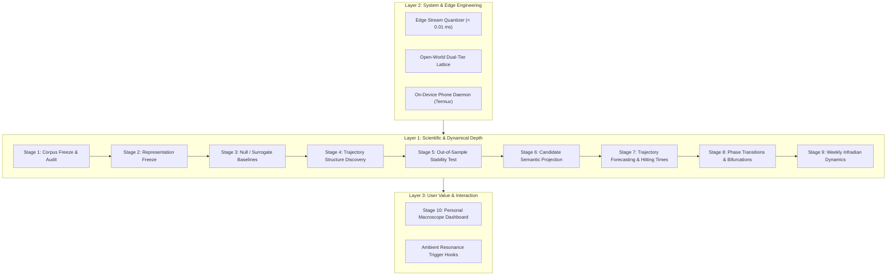

# Traceform

> **Objective**:  
> **"To determine whether persistent latent structure can be discovered from continuous natural human trajectories without predefined behavioral semantics."**  
> **「检验在没有预定义行为语义的条件下，能否从连续自然人类轨迹中发现持久的潜在结构。」**

[]()
[]()
[]()
[]()
[]()
[-purple)]()

---

## 1. Scientific Motivation

Traceform is a longitudinal physical trajectory observation and unsupervised structure discovery system.

Instead of pre-injecting behavioral categories (*home, work, sleep, commute, exercise, resting*), Traceform observes continuous low-level multimodal physical sensor data in the wild (motion dynamics, barometric pressure, light levels, spatial geocells, connectivity fingerprints, battery charge state, acoustic features) to evaluate:

1. **Recurrence**: Which states recur naturally over days and weeks?
2. **Transition Stability**: Which transition paths form stable dynamic regimes?
3. **Periodicity & Motifs**: Which sub-sequences exhibit periodic structure?
4. **Out-of-Sample Persistence**: Which patterns persist across temporal partitions (Day 1–7 discovery vs. Day 8–14 validation)?
5. **Predictive Dynamics**: Can future states and hitting times be forecast from trajectory geometry?
6. **Phase Transitions**: How do habits dissolve and reorganize during life disruptions?
7. **Noise vs. Structure**: Which patterns differentiate from null / surrogate baseline models?

The fundamental research question is not *"What is this person doing right now?"*, but rather:  
**"Can a machine discover an individual's persistent life structure purely from continuous, unlabelled physical trajectory dynamics?"**

```text
Raw Trajectory  ───►  Structure Discovery  ───►  Temporal Stability  ───►  Predictive Dynamics  ───►  Semantic Projection
 (Unlabelled)           (Latent Tokens)            (Out-of-Sample)            (Forecasting)               (Post-Hoc Only)
```

---

## 2. Complete 10-Stage Scientific & Engineering Pipeline

The end-to-end closed loop spans across three foundational layers:



| Stage | Focus & Scope | Core Modules / Scripts | Key Empirical Finding | Status |
| :--- | :--- | :--- | :--- | :---: |
| **Stage 1** | **14-Day Corpus Freeze & Audit** | [`scripts/audit_trajectory_corpus.py`](scripts/audit_trajectory_corpus.py) | 5,961 obs, 791 trans, 1,433 episodes. 0 duplicates, 0 non-monotonic steps, single boot ID (`5a6d0da0-...`). Raw ledgers locked (`chmod 444`). | **AUDIT PASS** |
| **Stage 2** | **Representation Freeze** | [`traceform/representation/`](traceform/representation/)<br>[`scripts/freeze_representation.py`](scripts/freeze_representation.py) | 15-dim multimodal normalizer & topological-kinetic lattice fit strictly on $W_1$ (Day 1–7). 33 micro-states ($S_{01}..S_{33}$) discovered. | **LOCKED** |
| **Stage 3** | **Null / Surrogate Baselines** | [`traceform/null_models/`](traceform/null_models/)<br>[`scripts/run_null_baselines.py`](scripts/run_null_baselines.py) | 100 Monte Carlo runs across 5 surrogate models (Permutation, Markov 1st/2nd, Circadian, Block Bootstrap). Rejects noise & diurnal nulls ($p < 0.001$). | **QUALIFIED NULL REJECTION** |
| **Stage 4** | **Trajectory Structure Discovery** | [`traceform/discovery/`](traceform/discovery/)<br>[`scripts/run_structure_discovery.py`](scripts/run_structure_discovery.py) | Non-linear RQA: $DET=67.48\%$, $LAM=74.46\%$. 35 dynamic regimes ($R_{01}..R_{35}$), 20 trajectory motifs ($M_{01}..M_{20}$), 33-node ergodic graph. | **STRUCTURE DISCOVERED** |
| **Stage 5** | **Out-of-Sample Stability Test** | [`traceform/stability/`](traceform/stability/)<br>[`scripts/verify_temporal_stability.py`](scripts/verify_temporal_stability.py) | $W_1 \to W_2$ validation. $96.2\%$ $W_2$ frames covered by $W_1$ vocab. Rank corr $\rho = 0.8989$. JSD to Null ratio $0.0941$. $100\%$ motif recurrence. | **CONFIRMED STABLE** |
| **Stage 6** | **Candidate Semantic Projection** | [`traceform/semantics/`](traceform/semantics/)<br>[`scripts/project_candidate_semantics.py`](scripts/project_candidate_semantics.py) | Post-hoc reverse projection of $S_k, R_j, M_m$ to physical observables (lux, accel, charging, RF) under strict epistemic quarantine. | **SYNTHESIZED** |
| **Stage 7** | **Trajectory Forecasting & Hitting Times** | [`traceform/forecasting/`](traceform/forecasting/)<br>[`scripts/run_trajectory_forecasting.py`](scripts/run_trajectory_forecasting.py) | Variable-order Markov predictor: **Top-1 Acc 88.41%** (Persist baseline 87.59%, Unigram 30.95%), Top-3 Acc 93.21%. Resolves active transition bifurcations. | **PREDICTIVE POWER AUDITED** |
| **Stage 8** | **Phase Transitions & Bifurcations** | [`traceform/dynamics/`](traceform/dynamics/)<br>[`scripts/detect_phase_transitions.py`](scripts/detect_phase_transitions.py) | 195 sliding windows evaluated. Isolated 6 critical phase transition alerts (3.1% of timeline) marked by entropy surges ($z \ge 2\sigma$). | **BIFURCATIONS DETECTED** |
| **Stage 9** | **Weekly Infradian Dynamics** | [`traceform/dynamics/infradian.py`](traceform/dynamics/infradian.py)<br>[`scripts/audit_weekly_infradian.py`](scripts/audit_weekly_infradian.py) | 4,336 weekday vs 1,625 weekend frames. Shared state rank correlation $\rho = 0.9000$, Cosine similarity $0.9182$, JSD $0.0306$ bits. | **INFRADIAN COHERENCE AUDITED** |
| **Stage 10** | **Personal Macroscope Dashboard** | [`traceform/ui/`](traceform/ui/)<br>[`scripts/generate_macroscope_ui.py`](scripts/generate_macroscope_ui.py) | Self-contained interactive HTML dashboard ([`macroscope_dashboard_v1.html`](artifacts/macroscope_dashboard_v1.html)) with canvas RQA plot and attractor graph. | **VISUAL DASHBOARD READY** |

---

## 3. Key Findings & Empirical Proofs

### A. Rigorous Null Model Testing (5 Stochastic Surrogates)
Hypothesis testing against 5 Monte Carlo surrogate ensembles (100 iterations each):
- **Permutation Null (Model 0)**: **REJECTED ($z = -398.73, p < 0.001$)**. Empirical entropy rate ($H = 0.419\text{ bits}$) proves trajectory is not memoryless I.I.D. noise.
- **Circadian Phase Null (Model 2)**: **REJECTED ($z = -150.25, p < 0.001$)**. Diurnal 24h phase preservation alone cannot account for multi-day coherence.
- **Block Bootstrap Null (Model 3)**: **REJECTED ($z = -21.35, p < 0.001$)**. Shuffling 15-minute blocks destroys long-range trajectory structure, confirming macro-temporal ordering.
- **1st-Order & 2nd-Order Markov Nulls (Models 1 & 4)**: **QUALIFIED PENETRATION ($p > 0.05$)**. Empirical 1-step transition statistics sufficiently reproduce short-range transition entropy and 3-gram motif recurrence. Demonstrates that trajectory dynamics at this quantization scale are primarily governed by ergodic Markovian transition geometry.

### B. Macroscopic Dynamic Regimes & Motifs
- **Non-Linear RQA**: Recurrence Rate $RR = 16.35\%$, Determinism $DET = 67.48\%$, Laminarity $LAM = 74.46\%$, Trapping Time $TT = 5.13\text{ steps}$.
- **Dynamic Regimes**: The continuous trajectory segments into 35 coherent macroscopic epochs.
- **Trajectory Motifs**: 20 recurring multi-step sequences discovered via Minimum Description Length (MDL) principles (e.g. $M_{01}: S_{08} \to S_{01} \to S_{01} \dots$, $M_{02}: S_{10} \to S_{02} \to S_{02} \dots$).

### C. Out-of-Sample Temporal Invariance ($W_1 \to W_2$)
- **State Space Generalization**: $96.20\%$ of all temporal duration in Week 2 ($W_2$) is accounted for by the state lattice learned exclusively on Week 1.
- **Stationary Rank Correlation**: $\rho = 0.8989$ ($p < 10^{-5}$) across shared states.
- **Transition Matrix Similarity**: Weighted Jensen-Shannon Divergence $D_{\text{JS}}(P_{W1} \parallel P_{W2}) = 0.0450\text{ bits}$, which is only **$9.4\%$** of the distance to a memoryless null baseline ($0.4780\text{ bits}$).
- **Motif Recurrence**: **$100\%$** of the top 20 trajectory motifs discovered in Week 1 repeated organically in Week 2.

### D. Forward Predictive Dynamics & Baseline Contrast
- **Top-1 Forward Accuracy**: **88.41%** out-of-sample prediction on Week 2 using Week 1 transition rules.
- **Baseline Contrast (Persist vs Unigram)**:
  - Naive Persist Baseline ("predict state remains identical"): **87.59%** (driven by high temporal inertia).
  - Unigram Stationary Prior ("predict most common state"): **30.95%** (2.86x lift).
  - The variable-order predictor correctly anticipates state-switch transitions that simple inertia cannot resolve.
- **Top-3 Accuracy**: **93.21%**; **Top-5 Accuracy**: **94.74%**.
- **Perplexity**: Reduced to **2.05** (vs uniform $\sim 33.0$).

### E. On-Device Edge Streaming Performance (GrapheneOS / Pixel 6a)
- **Sub-Millisecond Edge Inference**: Average latency of **0.008 ms/frame** (8 microseconds) with peak latency $< 0.040\text{ ms}$.
- **Zero-CPU Overhead**: Capable of streaming micro-state quantization inside Termux background runtime without battery penalty.

---

## 4. Repository Structure

```text
traceform/
├── data/
│   └── raw/
│       └── .pixel_sensorium/              # Immutable raw sensor ledgers (chmod 444)
├── traceform/                             # Core library packages
│   ├── representation/                    # Stage 2: Normalizers, Lattices & Open-World Manager
│   │   ├── normalizer.py
│   │   ├── metrics.py
│   │   ├── lattice.py
│   │   ├── data_driven_quantizer.py       # Unsupervised k-means clustering quantizer
│   │   └── open_world.py
│   ├── null_models/                       # Stage 3: Permutation, Markov, Diurnal Phase nulls
│   │   └── surrogates.py
│   ├── discovery/                         # Stage 4: RQA, Regimes, Motifs, Transition Graph
│   │   ├── recurrence.py
│   │   ├── regimes.py
│   │   ├── motifs.py
│   │   └── transition_graph.py
│   ├── stability/                         # Stage 5: Out-of-sample temporal invariance validator
│   │   └── temporal_validator.py
│   ├── semantics/                         # Stage 6: Post-hoc physical reverse projector
│   │   └── projector.py
│   ├── forecasting/                       # Stage 7: Trajectory predictor & hitting time estimator
│   │   └── predictor.py
│   ├── dynamics/                          # Stage 8 & 9: Bifurcations & Weekly Infradian Dynamics
│   │   ├── bifurcation.py
│   │   └── infradian.py
│   ├── streaming/                         # Layer 2: Lightweight on-device edge quantizer
│   │   └── edge_quantizer.py
│   ├── ui/                                # Layer 3: Macroscope Dashboard generator
│   │   └── macroscope_generator.py
│   └── intervention/                      # Layer 3: Ambient resonance trigger hooks
│       └── resonance_hooks.py
├── scripts/                               # Reproducible runner scripts
│   ├── audit_trajectory_corpus.py         # Stage 1 runner
│   ├── freeze_representation.py           # Stage 2 runner
│   ├── run_null_baselines.py              # Stage 3 runner
│   ├── run_structure_discovery.py         # Stage 4 runner
│   ├── verify_temporal_stability.py       # Stage 5 runner
│   ├── project_candidate_semantics.py     # Stage 6 runner
│   ├── run_trajectory_forecasting.py      # Stage 7 runner
│   ├── detect_phase_transitions.py        # Stage 8 runner
│   ├── audit_weekly_infradian.py          # Stage 9 runner
│   ├── generate_macroscope_ui.py          # Stage 10 runner
│   ├── phone_edge_stream_daemon.py        # Edge streaming daemon
│   ├── benchmark_dual_quantization.py     # Dual-Track Quantization Benchmark (Lattice vs Data-Driven)
│   └── run_traceform_pipeline.py          # Master End-to-End Pipeline CLI (10 Stages)
├── artifacts/                             # Immutable audit reports & specifications
│   ├── quantization_benchmark_v1/         # Dual-track benchmark specifications & report
│   ├── trajectory_corpus_v1/              # Stage 1 audit reports & manifest
│   ├── representation_v1/                 # Stage 2 state sequence & specs
│   ├── null_baselines_v1/                 # Stage 3 null benchmark reports
│   ├── structure_discovery_v1/            # Stage 4 discovery specs & RQA report
│   ├── temporal_stability_v1/             # Stage 5 temporal stability audit
│   ├── semantic_projection_v1/            # Stage 6 candidate semantic projections
│   ├── forecasting_v1/                    # Stage 7 trajectory forecasting stats & report
│   ├── phase_transitions_v1/              # Stage 8 bifurcation detection report
│   ├── infradian_v1/                      # Stage 9 weekly infradian dynamics report
│   └── macroscope_dashboard_v1.html       # Stage 10 interactive HTML dashboard
└── tests/                                 # 37 unit tests across 11 test modules (100% PASS)
    ├── test_representation_*.py
    ├── test_data_driven_quantizer.py      # Unsupervised clustering tests
    ├── test_null_models.py                # 5-surrogate model tests
    ├── test_discovery.py
    ├── test_stability.py
    ├── test_semantics.py
    ├── test_forecasting.py
    ├── test_dynamics.py
    ├── test_edge_quantizer.py
    ├── test_open_world.py
    └── test_intervention.py
```

---

## 5. Quick Start & Execution

### A. Run Unit Tests (37/37 Passing)
```bash
python3 -m unittest discover tests
```

### B. Run the Master End-to-End Pipeline (All 10 Stages in ~9.9s)
Execute all 10 stages sequentially in a single automated run:
```bash
python3 scripts/run_traceform_pipeline.py --all
```

Dry-run mode (verifies test suite and environment without re-running heavy stages):
```bash
python3 scripts/run_traceform_pipeline.py --dry-run
```

Run a specific stage (1 to 10):
```bash
python3 scripts/run_traceform_pipeline.py --stage 7
```

### C. Launch the Interactive Macroscope Dashboard
Open the compiled self-contained dashboard in your browser:
```bash
open artifacts/macroscope_dashboard_v1.html
```

---

## 6. Research Disciplines

1. **No Semantic Pre-injection**: The discovery layers operate exclusively on abstract tokens ($S_k, R_j, M_m$).
2. **Raw Evidence Immutability**: All original ledgers in `data/raw/` are byte-locked and never altered.
3. **Null Comparison Required**: No pattern is accepted as structure without decisive rejection of surrogate null baselines ($p < 0.001$).
4. **Out-of-Sample Temporal Invariance**: All discovered structural dynamics must generalize from training window $W_1$ to independent evaluation window $W_2$.
5. **Epistemic Quarantine**: Semantic hypotheses are quarantined strictly downstream as post-hoc interpretations and never feed back into the discovery engine.
