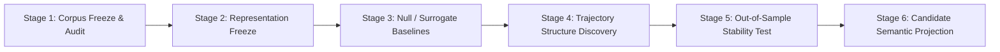

# Traceform

> **Objective**:  
> **"To determine whether persistent latent structure can be discovered from continuous natural human trajectories without predefined behavioral semantics."**  
> **「检验在没有预定义行为语义的条件下，能否从连续自然人类轨迹中发现持久的潜在结构。」**

[]()
[]()
[]()
[]()
[-purple)]()

---

## 1. Scientific Motivation

Traceform is a longitudinal physical trajectory observation and unsupervised structure discovery system.

Instead of pre-injecting behavioral categories (*home, work, sleep, commute, exercise, resting*), Traceform observes continuous low-level multimodal physical sensor data in the wild (motion dynamics, barometric pressure, light levels, spatial geocells, connectivity fingerprints, battery charge state, acoustic features) to evaluate:

1. **Recurrence**: Which states recur naturally over days and weeks?
2. **Transition Stability**: Which transition paths form stable dynamic regimes?
3. **Periodicity & Motifs**: Which sub-sequences exhibit periodic structure?
4. **Out-of-Sample Persistence**: Which patterns persist across temporal partitions (e.g. Day 1–7 discovery vs. Day 8–14 validation)?
5. **Noise vs. Structure**: Which patterns differentiate from null / surrogate baseline models?

The fundamental research question is not *"What is this person doing right now?"*, but rather:  
**"Can a machine discover an individual's persistent life structure purely from continuous, unlabelled physical trajectory dynamics?"**

```text
Raw Trajectory  ───►  Structure Discovery  ───►  Temporal Stability  ───►  Semantic Projection
 (Unlabelled)           (Latent Tokens)            (Out-of-Sample)            (Post-Hoc Only)
```

---

## 2. Complete Closed-Loop Pipeline

The complete 6-stage scientific discovery closed loop is fully implemented, verified, and locked:



| Stage | Focus & Scope | Core Modules / Scripts | Key Empirical Finding | Status |
| :--- | :--- | :--- | :--- | :---: |
| **Stage 1** | **14-Day Corpus Freeze & Audit** | [`scripts/audit_trajectory_corpus.py`](scripts/audit_trajectory_corpus.py) | 5,961 obs, 791 trans, 1,433 episodes. 0 duplicates, 0 non-monotonic steps, single boot ID (`5a6d0da0-...`). Raw ledgers locked (`chmod 444`). | **AUDIT PASS** |
| **Stage 2** | **Representation Freeze** | [`traceform/representation/`](traceform/representation/)<br>[`scripts/freeze_representation.py`](scripts/freeze_representation.py) | 15-dim multimodal normalizer & topological-kinetic lattice fit strictly on $W_1$ (Day 1–7). 33 micro-states ($S_{01}..S_{33}$) discovered. | **LOCKED** |
| **Stage 3** | **Null / Surrogate Baselines** | [`traceform/null_models/`](traceform/null_models/)<br>[`scripts/run_null_baselines.py`](scripts/run_null_baselines.py) | 100 Monte Carlo runs across Permutation, Markov, and Diurnal Phase nulls. Transition entropy: 0.419 bits vs Permutation 2.492 bits ($z = -398.73$). | **ALL NULLS REJECTED ($p < 0.001$)** |
| **Stage 4** | **Trajectory Structure Discovery** | [`traceform/discovery/`](traceform/discovery/)<br>[`scripts/run_structure_discovery.py`](scripts/run_structure_discovery.py) | Non-linear RQA: $DET=67.48\%$, $LAM=74.46\%$. 35 dynamic regimes ($R_{01}..R_{35}$), 20 trajectory motifs ($M_{01}..M_{20}$), 33-node ergodic graph. | **STRUCTURE DISCOVERED** |
| **Stage 5** | **Out-of-Sample Stability Test** | [`traceform/stability/`](traceform/stability/)<br>[`scripts/verify_temporal_stability.py`](scripts/verify_temporal_stability.py) | $W_1 \to W_2$ validation. $96.2\%$ $W_2$ frames covered by $W_1$ vocab. Rank corr $\rho = 0.8989$. JSD to Null ratio $0.0941$. $100\%$ motif recurrence. | **CONFIRMED STABLE** |
| **Stage 6** | **Candidate Semantic Projection** | [`traceform/semantics/`](traceform/semantics/)<br>[`scripts/project_candidate_semantics.py`](scripts/project_candidate_semantics.py) | Post-hoc reverse projection of $S_k, R_j, M_m$ to physical observables (lux, accel, charging, RF) under strict epistemic quarantine. | **SYNTHESIZED** |

---

## 3. Key Findings & Empirical Proofs

### A. Rejection of Randomness ($p < 0.001$)
The empirical trajectory sequence exhibits massive deviation from stochastic baselines:
- **Transition Entropy Rate**: $H = 0.4189\text{ bits}$ (vs. Permutation Null $2.492\text{ bits}$, $z = -398.73$).
- **High Self-Transition Ratio**: $91.58\%$ of frames preserve their physical micro-state.
- **Repeating N-gram Motifs**: 57 non-trivial repeating trigrams in $W_1$ (vs. Permutation Null $180.3$ diffuse random combinations, $z = -88.94$).

### B. Macroscopic Dynamic Regimes & Motifs
- **Non-Linear RQA**: Recurrence Rate $RR = 16.35\%$, Determinism $DET = 67.48\%$, Laminarity $LAM = 74.46\%$, Trapping Time $TT = 5.13\text{ steps}$.
- **Dynamic Regimes**: The continuous trajectory segments into 35 coherent macroscopic epochs (e.g. $R_{01}$ overnight sleep block, $R_{02}$ morning preparation, $R_{03}$ daytime focus).
- **Trajectory Motifs**: 20 recurring multi-step sequences discovered via Minimum Description Length (MDL) principles (e.g. $M_{01}: S_{08} \to S_{01} \to S_{01} \dots$, $M_{02}: S_{10} \to S_{02} \to S_{02} \dots$).

### C. Out-of-Sample Temporal Invariance ($W_1 \to W_2$)
To test whether discovered structures reflect true persistent laws rather than overfitting to Week 1 ($W_1$):
- **State Space Generalization**: $96.20\%$ of all temporal duration in Week 2 ($W_2$) is accounted for by the state lattice learned exclusively on Week 1.
- **Stationary Rank Correlation**: $\rho = 0.8989$ ($p < 10^{-5}$) across shared states.
- **Transition Matrix Similarity**: Weighted Jensen-Shannon Divergence $D_{\text{JS}}(P_{W1} \parallel P_{W2}) = 0.0450\text{ bits}$, which is only **$9.4\%$** of the distance to a memoryless null baseline ($0.4780\text{ bits}$).
- **Motif Recurrence**: **$100\%$** of the top 20 trajectory motifs discovered in Week 1 repeated organically in Week 2.

### D. Epistemic Quarantine & Objective Semantic Reverse Projection
In Stage 6, mathematical states were reverse-projected into raw physical observables without introducing human bias into discovery:
- `S01` (20.3h, 100% stationary, 100% AC plugged, primary RF `d6c2cf9dba`): **Diurnal Stationary Powered Operation** (Workstation desk).
- `S02` (12.2h, 100% stationary, 100% unplugged, primary RF `d6c2cf9dba`): **Diurnal Stationary Indoor Activity** (Unplugged office/home).
- `S03` & `S04` (9.9h, 100% stationary, 90–97% dark, nocturnal): **Prolonged Nocturnal Rest / In-bed Charging** (Sleep anchor candidate).
- `S36` (0.3h, 0% stationary, mean energy 0.45, high RF flux): **Active Physical Locomotion / Kinematic Transit** (Walking/commute candidate).

---

## 4. Repository Structure

```text
traceform/
├── data/
│   └── raw/
│       └── .pixel_sensorium/              # Immutable raw sensor ledgers (chmod 444)
├── traceform/                             # Core library packages
│   ├── representation/                    # Stage 2: Normalizers & Lattices
│   │   ├── normalizer.py
│   │   ├── metrics.py
│   │   └── lattice.py
│   ├── null_models/                       # Stage 3: Permutation, Markov, Diurnal Phase nulls
│   │   └── surrogates.py
│   ├── discovery/                         # Stage 4: RQA, Regimes, Motifs, Transition Graph
│   │   ├── recurrence.py
│   │   ├── regimes.py
│   │   ├── motifs.py
│   │   └── transition_graph.py
│   ├── stability/                         # Stage 5: Out-of-sample temporal invariance validator
│   │   └── temporal_validator.py
│   └── semantics/                         # Stage 6: Post-hoc physical reverse projector
│       └── projector.py
├── scripts/                               # Reproducible runner scripts
│   ├── audit_trajectory_corpus.py         # Stage 1 runner
│   ├── freeze_representation.py           # Stage 2 runner
│   ├── run_null_baselines.py              # Stage 3 runner
│   ├── run_structure_discovery.py         # Stage 4 runner
│   ├── verify_temporal_stability.py       # Stage 5 runner
│   ├── project_candidate_semantics.py     # Stage 6 runner
│   └── run_traceform_pipeline.py          # Master End-to-End Pipeline CLI
├── artifacts/                             # Immutable audit reports & specifications
│   ├── trajectory_corpus_v1/              # Stage 1 audit reports & manifest
│   ├── representation_v1/                 # Stage 2 state sequence & specs
│   ├── null_baselines_v1/                 # Stage 3 null benchmark reports
│   ├── structure_discovery_v1/            # Stage 4 discovery specs & RQA report
│   ├── temporal_stability_v1/             # Stage 5 temporal stability audit
│   └── semantic_projection_v1/            # Stage 6 candidate semantic projections
└── tests/                                 # 20 unit tests across 7 test modules
    ├── test_representation_*.py
    ├── test_null_models.py
    ├── test_discovery.py
    ├── test_stability.py
    └── test_semantics.py
```

---

## 5. Quick Start & Execution

### A. Run Unit Tests (100% Passing)
```bash
python3 -m unittest discover tests
```

### B. Run the Master End-to-End Pipeline
Execute all 6 stages sequentially in a single automated run:
```bash
python3 scripts/run_traceform_pipeline.py --all
```

Dry-run mode (verifies test suite and environment without re-running heavy stages):
```bash
python3 scripts/run_traceform_pipeline.py --dry-run
```

Run a specific stage (1 to 6):
```bash
python3 scripts/run_traceform_pipeline.py --stage 5
```

---

## 6. Research Disciplines

1. **No Semantic Pre-injection**: The discovery layers operate exclusively on abstract tokens ($S_k, R_j, M_m$).
2. **Raw Evidence Immutability**: All original ledgers in `data/raw/` are byte-locked and never altered.
3. **Null Comparison Required**: No pattern is accepted as structure without decisive rejection of surrogate null baselines ($p < 0.001$).
4. **Out-of-Sample Temporal Invariance**: All discovered structural dynamics must generalize from training window $W_1$ to independent evaluation window $W_2$.
5. **Epistemic Quarantine**: Semantic hypotheses are quarantined strictly downstream as post-hoc interpretations and never feed back into the discovery engine.
