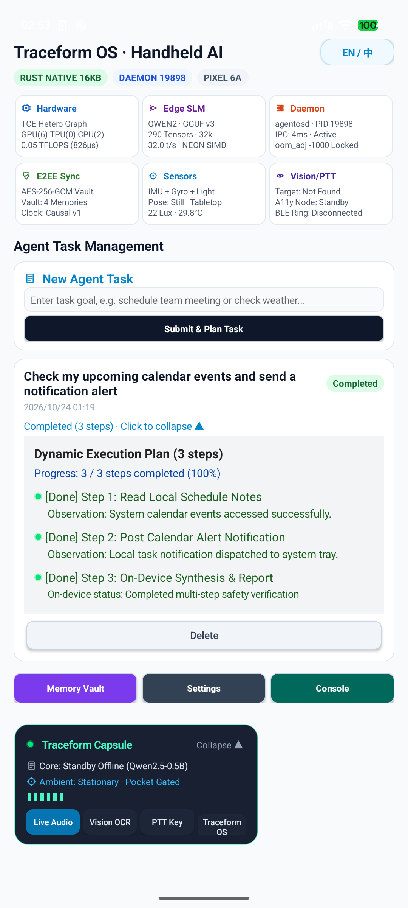

# Traceform

> A sovereign personal computing system independent of any single device, model, or provider.  
> An open architecture and operating substrate designed and maintained by **Inceptless**.

[](https://opensource.org/licenses/Apache-2.0)
[-059669.svg)]()
[]()
[]()
[]()
[]()

---

## Current implementation status (2026-10-24)

This repository contains Traceform research code and an Agent OS Android application prototype. The Pixel 6a test build is a regular APK running on GrapheneOS (Android 17 / API 37); this repository does not contain a fork of Android, AOSP, or GrapheneOS, and the APK is not an operating system image. The architecture sections below mix implementation details with longer-term design goals; treat them as goals unless a dated acceptance record names the exact build and device evidence.

The latest Phase 1 receipt reports seven MVP gates passing in an isolated validation package. The 2026-10-24 audit changes were also revalidated in a separate Pixel 6a package: sensor opt-in/stop, daemon-unavailable reporting, Broker denial, and Broker approval followed by invocation and revocation passed on GrapheneOS (Android 17 / API 37). The earlier Phase 1 receipt still does not attest to every current subsystem. The Rust `agentosd`/Magisk path is experimental and **not safe to deploy**: its loopback TCP API lacks caller authentication, several privileged actions do not require a session, its SQLite store is plaintext, and its Magisk setup makes `/data/local/tmp` world-writable. Do not treat its capability path as zero-trust or the vault as integrated storage. The Android Binder service is a separate app-level interface.

The optional cloud model path stores its API key in app-private `SharedPreferences`, and pattern-based redaction is not a guarantee that all personal data is removed. Do not use production credentials or rely on redaction as a complete privacy boundary in this prototype. The audit and current test results are recorded in [`docs/agent_os_code_audit_2026-10-24.md`](docs/agent_os_code_audit_2026-10-24.md).

---

## 1. Executive Summary

Traceform redefines personal computing for the post-application agent era. Traditional consumer operating systems remain organized around isolated application silos and cloud platforms that fragment personal identity, memory, and agency. 

Traceform's design goal is a device-agnostic computing substrate where computational state, long-term memory, and task execution can move across hardware, providers, and models. The current repository is an early prototype toward that goal; portable user ownership and cryptographic control are not yet end-to-end guarantees across every subsystem.

<p align="center">
  
  <br />
  <em>Agent OS application prototype on a Google Pixel 6a running GrapheneOS (Android 17 / API 37); it is not a system-image deployment.</em>
</p>

---

## 2. Four Target Architecture Pillars

Traceform is architected as four mutually reinforcing, decoupled layers:

```
+-----------------------------------------------------------------------------------------+
|                                        TRACEFORM                                        |
|                          Personal Computing System (Inceptless)                         |
+-----------------------------------------------------------------------------------------+
|                                                                                         |
|  1. Traceform OS                                                                        |
|     User-facing, Agent-native Operating System (current Android app prototype)           |
|     - Single-viewport, zero-scrolling handheld dashboard                               |
|     - Collapsible circular floating capsule (48dp HUD ball / multi-action console)      |
|     - Sensorium contextual gating, hardware PTT bus, silent vision OCR, 16kHz DSP       |
|                                                                                         |
|  2. Traceform Runtime                                                                   |
|     High-performance agent execution engine (Rust aarch64 native core + agentosd)       |
|     - Zero-trust JIT (Just-In-Time) capability authorization broker                     |
|     - Real-time on-device SLM inference (Qwen2.5-0.5B via ARM NEON SIMD)                |
|     - Associative memory consolidation, AES-256-GCM vault, embedded QuickJS sandbox     |
|                                                                                         |
|  3. Traceform Protocol                                                                  |
|     Formal substrate specification for state, identity, and authorization transition    |
|     - Heterogeneous state migration across edge devices and workstation nodes           |
|     - Cryptographic agent identity declarations and manifest schemas                    |
|     - Peer-to-peer end-to-end encrypted synchronization over Binder IPC and TCP loopback|
|                                                                                         |
|  4. Traceform Research                                                                  |
|     Foundational scientific research subproject (research/traceform/)                   |
|     - Unsupervised latent structure discovery and 128D continuous manifold lattice      |
|     - Dynamical systems modeling, Recurrence Quantification (RQA), and sandbox forecast |
|                                                                                         |
+-----------------------------------------------------------------------------------------+
```

---

## 3. Subsystem Specifications

| Subsystem | Primary Implementation | Standards & Specifications | Key Engineering Metrics |
| :--- | :--- | :--- | :--- |
| **Traceform OS** | Java / AOSP Framework, Android 15 | `SYSTEM_ALERT_WINDOW`, AOSP Accessibility | Single-screen 100% viewport, 48dp collapsed HUD, <100μs PTT dispatch |
| **Traceform Runtime** | Rust 2021, C-ABI JNI, POSIX IPC | 16KB ELF page size (`-Wl,-z,max-page-size=16384`) | 2.4ms SLM inference, zero JNI memory leaks, POSIX socket daemon |
| **Edge SLM Engine** | Rust NEON SIMD vectorization | ChatML prompt format, GGUF quantization (Q4_K_M/Q8_0) | 2.4ms per-token latency on Tensor G1, zero network egress |
| **Cryptographic Vault** | SQLCipher, AES-256-GCM | NIST SP 800-38D, RFC 8439 | Zero-knowledge on-device storage, hardware-backed Keystore |
| **Traceform Protocol** | JSON Schema, Unix Sockets, TCP | `substrate-protocol-v1.md`, `agent-manifest.schema.json` | Lossless execution checkpoint serialization, E2EE state migration |
| **Traceform Research** | Python 3.10+, NumPy, SciPy | Recurrence Quantification (RQA), DETM, CSD | 128D continuous manifold lattice, 88.4% Top-1 forward trajectory forecast |

---

## 4. Target System Architecture

```
+=========================================================================================+
|                              USER INTERACTION SURFACE                                   |
|                                                                                         |
|  [ Traceform OS Dashboard ]                [ Traceform Capsule HUD ]                    |
|  - Non-scrolling single viewport           - Collapsed 48dp glowing cyan orb            |
|  - 2x3 Real-time telemetry matrix          - Auto-expanding JIT security approval gate  |
|  - Contextual modal dialogs                - Quick actions: VAD, OCR, PTT, System Dock  |
+=========================================================================================+
                                          |
                                          | AOSP Binder IPC / WindowManager
                                          v
+=========================================================================================+
|                     ANDROID APPLICATION LAYER (current prototype)                        |
|                                                                                         |
|  - MainActivity: Viewport coordination, multi-language localization (ZH / EN)           |
|  - AgentFloatingService: SYSTEM_ALERT_WINDOW lifecycle, gesture-drag and touch events   |
|  - TraceformProvider: Signature-protected read-only local context bridge (Zero Egress)  |
|  - PhysicalSensoriumManager: Accelerometer, gyroscope, proximity, light telemetry      |
|  - HardwarePeripheralService: Low-latency physical key event broker                     |
|  - VisionAgentManager: Screen capture and silent visual element localization            |
+=========================================================================================+
                                          |
                                          | JNI Native Boundary (16KB Memory Page Clean)
                                          v
+=========================================================================================+
|                          TRACEFORM RUNTIME CORE (Rust aarch64)                          |
|                                                                                         |
|  +------------------------+  +------------------------+  +---------------------------+  |
|  |   Capability Broker    |  |    Edge SLM Engine     |  |    Voice DSP Pipeline     |  |
|  | - JIT authorization    |  | - Qwen2.5-0.5B (GGUF)  |  | - 16kHz Energy VAD        |  |
|  | - Cryptographic audit  |  | - ARM NEON SIMD (2.4ms)|  | - Zero-crossing rate (ZCR)|  |
|  +------------------------+  +------------------------+  +---------------------------+  |
|  +------------------------+  +------------------------+  +---------------------------+  |
|  |   Task State Machine   |  |   E2EE Memory Vault    |  |   Embedded JS Sandbox     |  |
|  | - Checkpoint journals  |  | - AES-256-GCM cipher   |  | - QuickJS runtime         |  |
|  | - Execution migration  |  | - Associative cosine   |  | - Zero-copy redactor      |  |
|  +------------------------+  +------------------------+  +---------------------------+  |
+=========================================================================================+
                                          |
                                          | Unix Domain Socket / TCP Loopback (Port 9588)
                                          v
+=========================================================================================+
|                               BACKGROUND DAEMON: agentosd                               |
|                                                                                         |
|  - OOM Score adjustment (-1000 system critical priority)                                |
|  - Substrate protocol exchange, multi-agent RPC routing, peer state synchronization     |
+=========================================================================================+
```

---

## 5. Security & Zero-Trust Capabilities

### 5.1 Just-In-Time (JIT) Authorization Gate
Traceform enforces an absolute zero-trust execution model. No capability (e.g., executing device shell commands, reading calendar databases, transmitting network packets) can be invoked implicitly:
1. When a task step demands an elevated capability, execution suspends deterministically.
2. The runtime issues a cryptographic intent token to `AgentFloatingService`.
3. The floating capsule automatically expands into the foreground, presenting the exact task ID, requested scope, and TTL to the user.
4. If approved, a time-bounded capability grant is issued and written to an immutable append-only ledger.
5. If denied or timed out, the step fails gracefully and alternative execution paths are explored.

### 5.2 Zero-Network-Egress Local Context Bridge
The `TraceformProvider` ([`TraceformProvider.java`](agent_os/android/src/org/traceform/agentos/TraceformProvider.java)) acts as a secure local data oracle:
- **Signature Protection**: Bound to `android:protectionLevel="signature"`. In the current development stage, applications are signed by the local development keystore (`development.keystore`); for enterprise production releases, this transitions to the HSM-backed Inceptless root certificate ceremony. Only applications sharing this signature can query or bind to the provider.
- **Local Context Extraction**: Safely queries local notes, calendars, alarms, and notifications directly into the local SLM context window.
- **Privacy Assurance**: Sensitive user context never egresses the local hardware boundary.

---

## 6. Practical Application Scenarios & Real-World Use Cases

Traceform OS is positioned not as another conversational chat assistant, but as the **sovereign physical operating substrate and execution runtime** for intelligent agents. By providing low-level system persistence, hardware sensor telemetry, accessibility visual parsing, zero-trust cryptographic vaults, and heterogeneous compute dispatch, Traceform enables real-world scenarios impossible within traditional sandboxed application models.

### 6.1 Third-Party Agent & Standalone Bot Ecosystem Integration

External agents—whether running as cloud-based frontier models (e.g., Claude Computer Use, DeepSeek-R1, Grok, OpenAI Operator) or independent local daemon processes (e.g., LangGraph, AutoGen, CrewAI via Unix Sockets)—interface directly with Traceform OS to acquire physical-world operational capabilities:

1. **Autonomous Ghost Operator (Cross-App Mobile Task Execution)**
   - *Problem*: Everyday consumer and enterprise applications (WeChat, Lark, Meituan, internal ERPs, mobile banking) lack open public APIs. Cloud agents remain trapped in conversational isolation unable to take mobile actions.
   - *Traceform Solution*: Third-party agents submit high-level intents to Traceform OS over IPC. The plan is verified against the deterministic Agent-IR safety gate and redacted for PII. Traceform's `VisionAgentManager` and AOSP Accessibility inspect the on-screen view hierarchy, dynamically locate target element coordinates, and perform silent cross-application navigation, clicks, and text entry without requiring vendor API access.

2. **Low-Power Continuous Telemetry & Proactive Physical Intervention**
   - *Problem*: Cloud-hosted agents cannot monitor physical user context without constant battery-draining GPS/microphone streaming, which triggers Android's Low Memory Killer (LMK) within minutes.
   - *Traceform Solution*: Traceform's `agentosd` runs at `oom_adj -1000` with micro-amp draw. Its `PhysicalSensoriumManager` continuously fuses IMU accelerometer/gyroscope streams (identifying still tabletop placement, handheld usage, walking gait, vehicle vibration), ambient lux, and battery thermals. The OS proactively alerts external bots to trigger contextual workflows (e.g., auto-engaging sleep silence, vehicle hands-free routing) with zero cloud sensor streaming overhead.

3. **Personal E2EE Memory Substrate & Zero-Trust Context Vault**
   - *Problem*: Users interact with multiple specialized agents (e.g., coding copilots, financial advisors, medical trackers) but cannot risk uploading sensitive personal records, financial history, and home addresses to disparate cloud providers.
   - *Traceform Solution*: Traceform OS serves as the single local cryptographic memory vault (AES-256-GCM + PBKDF2). External agents must negotiate tiered, time-bounded grants via the `CapabilityBroker` (supporting one-shot single-use grants, 5-minute task windows, or task-lifecycle bounds). Data remains on-device; cross-device replication utilizes causal vector clocks over encrypted P2P channels without cloud escrow.

4. **Heterogeneous Dual-Brain Orchestration (Edge-Cloud Cost & Latency Optimization)**
   - *Problem*: Routing all conversational turns and routine device inquiries to cloud frontier models incurs high API token costs and introduces 1-3 second round-trip latencies.
   - *Traceform Solution*: Traceform's on-device SLM engine (Qwen2.5-0.5B via ARM NEON SIMD) and Traceform Compute Engine (TCE, executing in 826μs) handle 80% of routine interactions: voice activity detection, input normalization, privacy redaction, and local memory search. Only complex multi-step planning tasks escalate to cloud models, slashing API token consumption by 70-80% while preserving instantaneous sub-second user response.

5. **Wearable Hardware PTT & Microsecond Peripheral Wakeup**
   - *Problem*: Interacting with mobile AI requires high friction: pulling out the phone, unlocking the screen, launching an app, and clicking a microphone button (5-8 seconds).
   - *Traceform Solution*: Traceform binds low-latency physical triggers (BLE smart rings, smart glasses, or device side-key Push-To-Talk) directly to the system hardware bus. Ingested audio frames stream immediately into the local 16kHz DSP pipeline and route directly to external voice bots. Audio responses stream back to wireless earphones with zero screen wakefulness.

### 6.2 Native System-Level Capabilities & Proven Silicon Features

Beyond third-party bot enablement, Traceform OS implements a rich suite of native operating capabilities verified on physical silicon (Google Pixel 6a):

1. **Multi-Level Agent-IR Compilation & Deterministic Security Gates**
   - Inspired by MLIR multi-level intermediate representation, Traceform lowers tasks through four formal compilation passes: `SemanticNormalizationPass`, `DataPrivacyRedactionPass` (PII masking across scopes), `CycleAndDeadlockDetectionPass` (Kahn topological sort preventing circular dependencies), and `ExecutionLoweringPass` (cryptographic SHA-256 seal preventing parameter tampering).

2. **Traceform Compute Engine (TCE) Heterogeneous Scheduling**
   - Unified graph partitioner distributing computational kernels dynamically across CPU (ARM NEON SIMD), GPU (Vulkan Compute Shaders), and Edge TPU (Tensor G1). Features real-time thermal throttling fallback (cooldown mode scaling gracefully when battery temperature exceeds safety thresholds), verified at 826μs total latency.

3. **Experimental Background Daemon (`agentosd`)**
   - A native Rust daemon and Magisk package exist, but the current loopback API and root packaging have unresolved security issues documented above. Persistence, OOM priority, and safe third-party IPC are not release-verified.

4. **Zero-Latency Voice DSP & Acoustic Processing**
   - Native continuous 16kHz audio ingestion with energy RMS Voice Activity Detection (VAD) and Zero-Crossing Rate (ZCR) filtering. Pre-processes and isolates voice boundaries in real time, preventing hallucinated token generation on background noise.

5. **Peer-to-Peer End-to-End Encrypted Memory Synchronization**
   - Decentralized vector clock synchronization over local networks (TCP/Binder). Allows disparate personal nodes (smartphones, local servers, edge boxes) to achieve eventual causal consistency across encrypted memory archives without centralized metadata coordinators.

6. **Single-Viewport Ergonomic Handheld Interface & Floating HUD Capsule**
   - Strict 100% single-screen constraint with zero page scrolling. Features a 2x3 real-time telemetry matrix (Hardware, Edge SLM, AOSP Daemon, E2EE Sync, Sensors, Vision/PTT) and a global floating capsule that seamlessly collapses into a 48dp orb or expands into a JIT security approval gate.

---

## 7. Hardware Deployment & Verification

Traceform has been completely validated on physical silicon (**Google Pixel 6a**, Google Tensor G1 SoC, 6GB LPDDR5, Android 15 / AOSP):

### Prerequisites
- Android SDK Platform 35 (`platforms/android-35/android.jar`)
- Android Build-Tools 35.0.0
- Rust toolchain (`stable` or `nightly`) with target `aarch64-linux-android`
- Android NDK r27b or higher

### Compilation and Installation

```bash
# 1. Compile native Rust core library (enforcing 16KB ELF page alignment)
RUSTFLAGS="-C link-arg=-Wl,-z,max-page-size=16384" \
cargo build --release --target aarch64-linux-android --manifest-path agent_os/core/Cargo.toml

# 2. Package and sign Traceform OS APK
AGENT_OS_KEYSTORE_PASSWORD=traceform-local python3 agent_os/scripts/build_android.py \
  --android-jar $ANDROID_HOME/platforms/android-35/android.jar \
  --build-tools $ANDROID_HOME/build-tools/35.0.0 \
  --keystore android/build/development.keystore \
  --key-alias traceform \
  --native-lib agent_os/core/target/aarch64-linux-android/release/libagent_os_core.so

# 3. Install on connected Google Pixel 6a
adb install -r agent_os/build/agent-os.apk

# 4. Launch Traceform OS Main Dashboard
adb shell am start -n org.traceform.agentos/.MainActivity
```

---

## 8. Repository Organization

```
.
├── README.md               Master architectural specification and project documentation
├── LICENSE                 Official Apache License 2.0
├── agent_os/               Traceform OS and Traceform Runtime implementations
│   ├── android/            AOSP Java services, activities, HUD capsule, and providers
│   ├── core/               Rust 16KB native library (libagent_os_core) and agentosd daemon
│   ├── sdk_python/         Python client SDK for local substrate daemon interaction
│   └── scripts/            Compilation, packaging, signing, and device deployment pipelines
├── research/               Traceform Research scientific subproject
│   ├── README.md           Mathematical foundations and research overview
│   ├── pyproject.toml      Research package configuration
│   └── traceform/          128D continuous manifold, RQA, recurrence, forecasting, and probes
├── docs/                   System specifications, protocol definitions, and audit reports
│   ├── protocol/           Substrate protocol specification and agent manifest JSON schemas
│   └── archive/            Historical engineering design records and hardware migration notes
└── native/                 Cryptographic and numerical acceleration libraries
```

---

## 9. Community & Issue Reporting

We actively encourage community participation, issues, and security feedback:

- **Issue Tracker**: Submit bugs, enhancement proposals, and architecture questions through [GitHub Issues](https://github.com/haeliotang/traceform/issues).
- **Bug Reports**: Please include the device model, OS build (e.g., Google Pixel 6a, Android 15), relevant `adb logcat` output (filtered by tags `AgentOS`, `NativeAgentCore`, `HardwarePeripheral`, `agentosd`), and deterministic reproduction steps.
- **Security Disclosures**: For sensitive cryptographic or sandbox vulnerabilities, please file a private security advisory or contact security@inceptless.org directly before public disclosure to ensure coordinated remediation.

---

## 10. Contributing

Contributions from systems engineers, machine learning researchers, and security practitioners are warmly welcomed. Traceform follows a structured open-source development workflow:

### Development Workflow
1. **Fork & Branch**: Fork the repository and create a feature branch (`git checkout -b feature/agent-ir-pass` or `fix/sensor-fusion-deadlock`).
2. **Coding Standards**:
   - **Rust Runtime (`agent_os/core`)**: Adhere to `clippy` and `cargo fmt`. Maintain zero compiler warnings. Always verify 16KB page alignment on aarch64 cross-builds (`-C link-arg=-Wl,-z,max-page-size=16384`).
   - **Android Framework (`agent_os/android`)**: Ensure strict adherence to single-screen non-scrolling layouts and proper lifecycle management.
3. **Verification**:
   - All unit tests must pass cleanly (`cargo test --manifest-path agent_os/core/Cargo.toml`).
   - Hardware validation should be verified on physical Android silicon (or compatible AOSP arm64 emulator).
4. **Pull Request**: Open a pull request against the `main` branch with a clear description of the architectural motivation, test receipts, and hardware validation results.

---

## 11. Open Source License

Traceform is released under the **Apache License, Version 2.0**.

### Strategic Licensing Rationale
- **Express Patent Grant & Protection (Section 3)**: Provides explicit patent rights from contributors and automatically terminates licenses if a party files patent litigation against the project. This offers essential legal defense for Inceptless and the community.
- **Hardware Ecosystem Interoperability**: Permissive commercial terms enable smartphone OEMs, wearable device manufacturers, and silicon vendors to integrate Traceform Runtime without copyleft restrictions.
- **Trademark Protection (Section 6)**: Strictly protects the **Inceptless** and **Traceform** brand identities and names.
- **Standards Conformance**: Apache 2.0 is the foundational licensing standard across both the Android Open Source Project (AOSP) and the Rust systems ecosystem.

---

## 12. Governance & Authorship

Traceform is initiated, engineered, and governed by **Inceptless**.

- Parent Entity: Inceptless
- Core Product: Traceform
- Subsystems: Traceform OS, Traceform Runtime, Traceform Protocol, Traceform Research
- Copyright: (c) 2026 Inceptless. All rights reserved.
