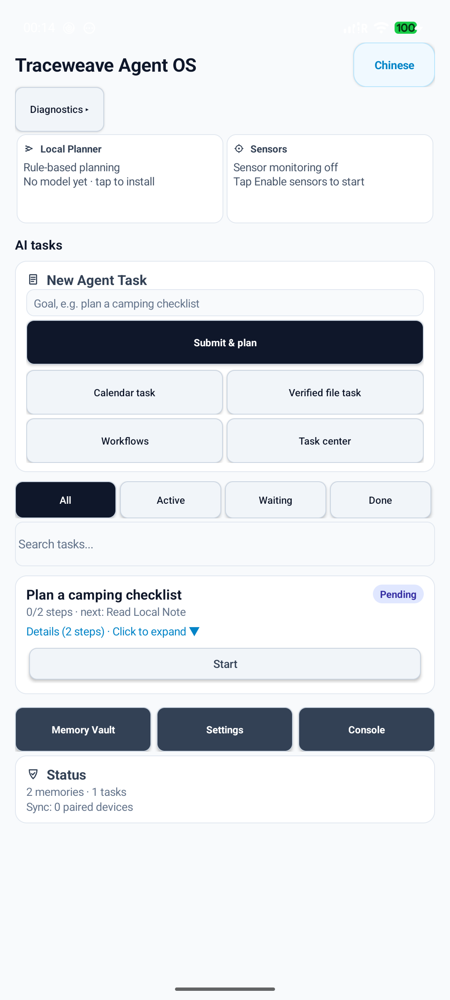
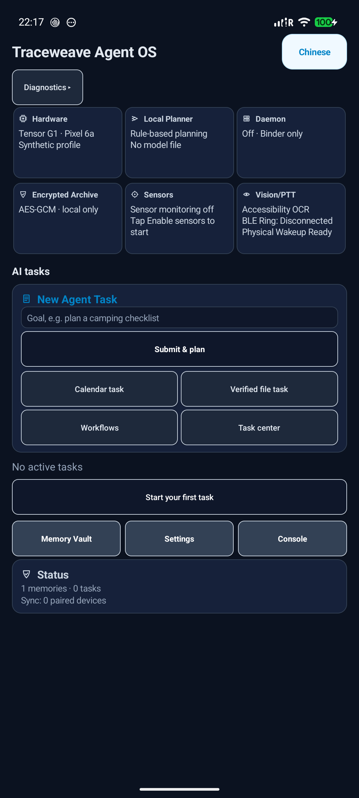
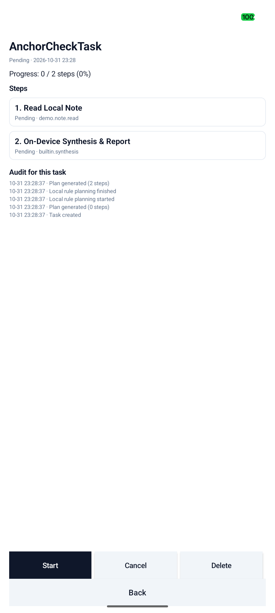
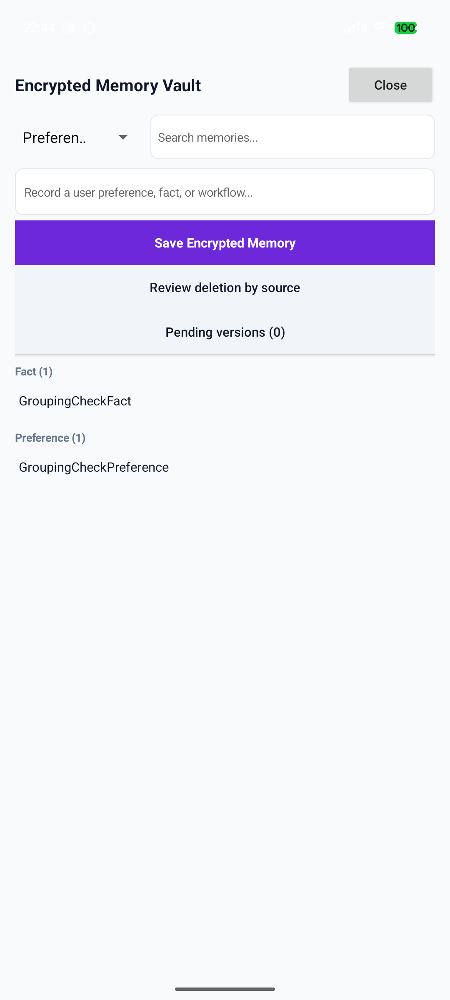
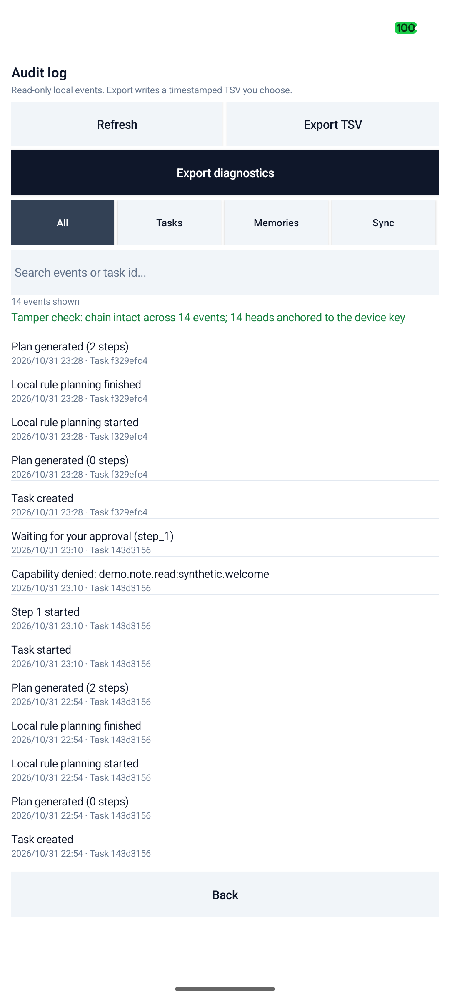
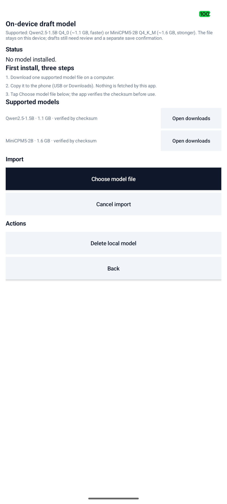

# Traceweave

> 一套不依赖单一设备、单一模型或单一服务商的主权个人计算系统。  
> 由 **Inceptless** 设计与维护的开放架构与运行基底。

[English](README.md) | [中文](README.zh-CN.md)

版本之间的变更见 [CHANGELOG.md](CHANGELOG.md)。

> **这是原型，不是可生产使用的软件。** 在 1.0 之前会有缺失、粗糙和破坏性变更。

[](https://opensource.org/licenses/Apache-2.0)
[-059669.svg)]()
[]()
[]()
[]()
[](docs/agent_os_model_document_acceptance.md)

---

## 1. 概述

Traceweave 面向后应用时代的个人计算：传统系统仍围绕孤立的应用与云端平台组织，把身份、记忆与主动权切碎在各个孤岛里。

Traceweave 的设计目标是一个**设备无关的计算基底**：计算状态、长期记忆与任务执行可以在硬件、服务商与模型之间迁移。当前仓库是这个目标的早期原型；**可携带的数据主权与密码学控制尚未在所有子系统中端到端成立**。

<p align="center">
  
  
  
  <br />
  
  
  
  <br />
  <sub>Pixel 6a，0.1.0 构建：首页（浅色/深色）、任务详情、记忆库、带防篡改校验的审计页、模型页。</sub>
</p>

---

## 2. 四层目标架构

| 层 | 目标 | 当前状态 |
| :--- | :--- | :--- |
| **L1 数据主权** | 数据留在本机，用户持有密钥与导出能力 | AES-GCM + Android Keystore、口令加密档案、墓碑优先合并；**尚无用户主密钥与恢复机制** |
| **L2 设备无关** | 计算状态可在多台设备间迁移 | 同机双包装对/同步已验证；**两台真机、局域网对端、后台可达性未验证** |
| **L3 本地智能** | 端侧模型完成规划与生成 | 现状：规划是**规则引擎**；可选导入的 Qwen2.5-1.5B / MiniCPM5-2B GGUF 只用于文档草稿，运行时未启用 GBNF 约束解码 |
| **L4 系统级落地** | 融入系统而非一个孤立 App | 通知、分享、文档选择器、静态快捷方式、审计页；**守护进程仍关闭** |

---

## 3. 子系统规格

| 子系统 | 主要实现 | 规格与标准 | 关键工程指标 |
| :--- | :--- | :--- | :--- |
| **Agent OS 原型** | Java Android APK，在 Android 17 上测试 | Android 应用沙箱 + 显式用户授权 | 不承诺 OS 镜像、延迟或续航 |
| **Traceweave Runtime** | Rust 2021，C-ABI JNI | 实验性原生核心；Rust 守护进程与 IPC 已关闭 | — |
| **本地规划器** | APK 内规则规划；可选用户导入的 GGUF 模型 | 不内置模型；可运行用户选择的模型文件 | 不声称吞吐基准 |
| **应用数据与档案** | Keystore AES-GCM；口令加密档案 | 档案格式带版本；未独立审计 | 不承诺零知识或硬件背书 |
| **Traceweave 协议** | JSON Schema、Android Binder、实验性 Rust 同步 | 守护进程 IPC 关闭 | 手动配对/同步在同机双包上已验证；**跨设备同步未验证**，后台同步由 JobScheduler 周期任务负责（不是"仅在应用打开时"） |
| **Traceweave Research** | Python 研究包 | 循环与动力系统方法 | 研究指标需自证可复现 |

---

## 4. 目标系统架构

```
+=========================================================================================+
|                                    用户交互层                                           |
|  [ Agent OS 应用界面 ]                    [ 可选悬浮窗服务 ]                            |
|  - 任务、记忆、设置的可滚动界面            - 需用户授予悬浮窗权限                       |
|  - 显式能力授权                            - 语音/视觉/外设为实验代码                    |
+=========================================================================================+
                                          |
                                          | AOSP Binder IPC / WindowManager
                                          v
+=========================================================================================+
|                           Android 应用层（当前原型）                                     |
|  - MainActivity：界面编排、双语（中/英）                                                |
|  - AgentFloatingService：SYSTEM_ALERT_WINDOW 生命周期与手势                              |
|  - TraceweaveProvider：签名保护的可选本地上下文桥                                         |
|  - PhysicalSensoriumManager：显式启停的传感器原型                                         |
|  - VisionAgentManager：实验性，未获准用于通用 UI 自动化                                   |
+=========================================================================================+
                                          |
                                          | 可选 JNI 边界（部署未达发布标准）
                                          v
+=========================================================================================+
|                              实验性 Rust 组件                                           |
|  用户授权 · 任务级授权 · 确定性规则 · 用户导入模型 · 任务日志 · Keystore 加密数据         |
+=========================================================================================+
                                          |
                                          | 无运行中的守护进程传输
                                          v
+=========================================================================================+
|                          agentosd：已禁用                                              |
+=========================================================================================+
```

---

## 5. 能力审批与隐私边界

### 5.1 即时（JIT）授权门禁

请求绑定调用方 UID、包名、任务、能力与数据范围。跨应用调用会展示系统授权界面；授权最长 5 分钟，拒绝、超时、过期或撤销都会**失败关闭**并记入本机审计。这是应用层原型，不是系统级零信任边界，也不是不可篡改账本。

### 5.2 可选本地上下文桥

`TraceweaveProvider` 是可选适配器：

- **签名保护**：`protectionLevel="signature"`，要求两端签名一致；当前 Agent OS 与 Edge 应用共用同一签名身份，集成已验证可用。
- **验证范围**：包含（a）有界的合成历史摘要测试，以及（b）2026-10-31 一次**真实生产读取**——通过受签名保护的 Binder 服务、经用户授权 5 分钟。该次读取只返回结构化字段（例如 `history_records = 3461`），未读取或记录任何历史行、个人内容、日历或通知；收据同时记录 Edge 当时上报 stale initial state，因此没有可评估的预测。
- **隐私边界**：数据经签名保护的 Binder 返回；应用声明 `INTERNET` 仅用于可选云端推理，全局配置本身不构成传输授权。每次云端规划都需**精确载荷预览 + 一次性确认**，后续观察结果留在本机。

---

## 6. 应用场景与用例

本节描述产品假设与实验组件，**不代表当前原型已交付的能力**。仓库不包含 AOSP 分支、已部署的第三方守护进程、跨应用自主控制、持续传感器监控、可穿戴集成或跨设备后台同步。

### 6.1 第三方 Agent 生态

外部 agent 互操作是方向，不是现状。现有验证覆盖应用内任务流与范围受限的 Binder 能力示例。

### 6.2 个人知识工作流

任务 → 计划 → 逐步执行 → 记忆沉淀 → 审计可查。端侧模型在无网络条件下完成规划与整理。

### 6.3 验证工具箱

| 脚本 | 证明什么 | 何时运行 |
| :--- | :--- | :--- |
| `agent_os/tests/`（`unittest discover`） | 文案目录、占位符、硬编码棘轮、包名一致性、发布元数据 | 每次改动 |
| `release_preflight_android.py` | 构建、签名、打包输入、升级路径、宿主测试、发布说明 | 发版前 |
| `smoke_candidate_android.py` | 候选包能装、能启动、首屏正常 | preflight 之后 |
| `device_regression_android.py` | 动作流、工作流、文稿流（`--suite documents` 跑文稿链） | 改 UI 或文案后 |
| `measure_power_android.py` | 未插电时的电量斜率（充电时拒绝运行） | 功耗工作 |
| `check_a11y_android.py` | 当前屏可点击控件都有语音标签 | 无障碍工作 |

### 6.4 当前验证状态

三层验证的最近结果见 [阶段状态报告](docs/stage_status_2026-10-31.md)：宿主测试、设备回归、发布前检查各自的命令、结果与产物路径，以及**这套验证不覆盖什么**。

---

## 7. 硬件部署与验证

原型在运行 GrapheneOS / Android 17 的 **Google Pixel 6a** 上验证过。这只能证明特定应用行为，不构成 AOSP 镜像验证或发布就绪结论。参见[验收记录](docs/agent_os_phase1_acceptance.md)。

### 依赖

- Android SDK Platform 35
- Android Build-Tools 35.0.0
- Rust 工具链（stable/nightly），目标 `aarch64-linux-android`
- Android NDK r27b 或更高

### 构建与安装

```bash
# 可选：实验性 Rust 核心（守护进程不可部署）
RUSTFLAGS="-C link-arg=-Wl,-z,max-page-size=16384" \
cargo build --release --target aarch64-linux-android --manifest-path agent_os/core/Cargo.toml

# 应用候选包
python3 agent_os/scripts/release_preflight_android.py \
  --android-jar "$HOME/Library/Android/sdk/platforms/android-35/android.jar" \
  --build-tools "$HOME/Library/Android/sdk/build-tools/35.0.0" \
  --keystore <keystore.p12> --key-alias <alias> \
  --model-runtime <libtraceweave_local_model.so> \
  --sync-runtime <libtraceweave_sync.so> \
  --output-dir agent_os/build/preflight-<date>
```

完整流程与已知坑见[发布手册](docs/release_runbook_2026-10-31.md)。

---

## 8. 仓库结构

```
.
├── README.md               英文版总览
├── README.zh-CN.md         中文版总览（本文件）
├── LICENSE                 Apache License 2.0
├── agent_os/               Agent OS 原型与实验性 Rust 组件
│   ├── android/            Android 应用（服务、界面、悬浮窗、Provider）
│   ├── core/               Rust 原生库（守护进程关闭）
│   ├── scripts/            构建、打包、签名、设备验证流水线
│   └── tests/              宿主测试与设备验证用例
├── research/               Traceweave Research 研究子项目
├── docs/                   规格、协议、审计与状态报告
└── native/                 数值与密码学加速库
```

---

## 9. 社区与问题反馈

- **问题追踪**：[GitHub Issues](https://github.com/haeliotang/traceweave/issues)
- **缺陷报告**：请附设备型号、系统版本、相关 `adb logcat`（可用标签 `AgentOsValidation`、`SubstrateService`、`AgentOS`、`NativeAgentCore` 过滤）与可复现步骤。
- **安全披露**：请私下发送至 support@inceptless.com，参见 [SECURITY.md](SECURITY.md)。公开 issue 中不要包含凭据或设备隐私数据。

---

## 10. 贡献

欢迎系统工程师、机器学习研究者与安全从业者参与，范围、合成夹具与可复现要求见 [CONTRIBUTING.md](CONTRIBUTING.md)。

1. **Fork 并开分支**；
2. **代码规范**：Rust 侧遵循 `clippy`/`cargo fmt` 并保持 aarch64 16KB 页对齐；Android 侧保持生命周期处理、可见的用户授权与权限检查；
3. **验证**：单元测试、设备回归、发布前检查至少跑通其一对应层级；
4. **提交 PR**：说明架构动机、测试收据与设备验证结果。

---

## 11. 开源许可

以 **Apache License, Version 2.0** 发布，见 [LICENSE](LICENSE)。第三方组件保留各自许可，分发时请保留其声明。

---

## 12. 治理与作者

Traceweave 由 **Inceptless** 发起、工程化并治理。

- 母实体：Inceptless
- 核心产品：Traceweave
- 子系统：Traceweave OS、Traceweave Runtime、Traceweave Protocol、Traceweave Research
- 版权：(c) 2026 Inceptless。代码以 Apache License 2.0 授权（见 [LICENSE](LICENSE)）；「Traceweave」名称与标识仍为 Inceptless 的商标。
