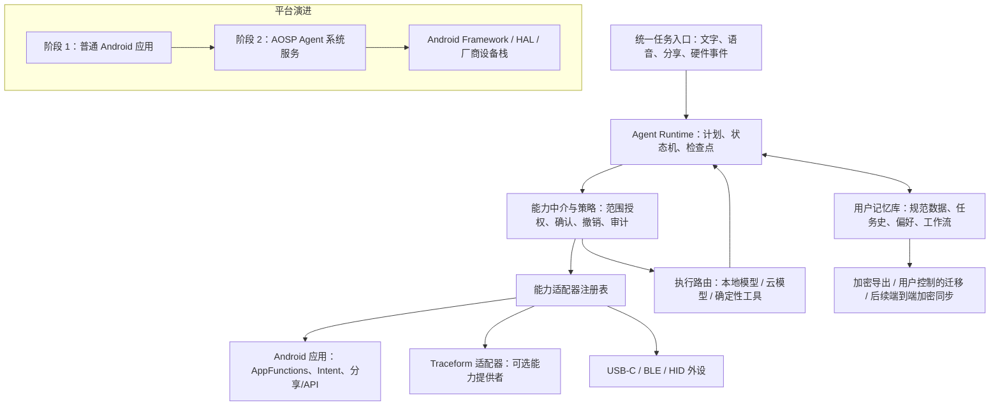

# Agent 原生移动操作系统：开发方案与平台决策

> 状态：任务与用户记忆迁移原型、确定性本地执行器已落地；阶段 1 MVP 的 7 个退出门槛已在 Pixel 6a（GrapheneOS）上 100% 全部通过真机验收（含真实 UI 暂停/继续/取消/删除交互、受控 Broker 与短时审计、离线/飞行模式执行、v4 记忆治理与内存索引、墓碑绝对优先与冲突选择、Traceform Provider 端到端 UI 闭环，以及仿真放电模式下的定量能耗与 GrapheneOS 权限沙盒验证）；阶段 2 应用能力生态验证已通过 · 更新日期：2026-10-23 · 仓库：Traceform（与 Agent OS 共用同一 GitHub 远端）
> 阶段 1 逐项验收结论与 Pixel 6a 证据见 [阶段 1 验收记录](agent_os_phase1_acceptance.md) 与综合验收收据 [`artifacts/agent_os/phase1/phase1_mvp_complete_device_receipt.json`](../artifacts/agent_os/phase1/phase1_mvp_complete_device_receipt.json)。当前真机已完成数据库 v1→v4 迁移、记忆来源追踪、可重建内存索引、导入冲突二选一、墓碑优先、系统飞行模式本地执行、force-stop 恢复、整机重启跨系统启动恢复，真实 UI 界面控件（暂停/继续/取消/删除）实拍取证，Traceform 可选 Provider 的真实 UI 授权与 Binder 读取，以及定量电量与 GrapheneOS 权限审计。

## 1. 决策摘要

**建议先以 Android 应用生态为产品起点，再逐步下沉到 AOSP 系统层；暂不以通用 Linux 手机发行版作为首个平台，也不从 GrapheneOS 分叉构建 Agent OS。**

这不是把现有 App 启动器换成聊天框。Agent 应成为任务的创建、调度、恢复和审计主体；应用逐步成为由用户授权、可被调用的能力提供者。早期用普通 Android 应用验证任务运行时、权限中介和用户记忆格式；当应用级 API 确实挡住目标能力时，再建立自己的 AOSP 系统服务和系统镜像。

Pixel 6a 当前运行 GrapheneOS，**不妨碍第一阶段**：它适合开发和验证普通 Android 应用、隐私开关、权限及后台行为。它**不能代表未来的 Agent OS 系统镜像**：自定义系统要独立维护设备构建、签名、Verified Boot、OTA、安全更新和 Google 服务兼容性；刷入会替换当前系统并清除设备数据。

Traceform 与 Agent OS 可以共享 `https://github.com/haeliotang/traceform.git` 这个远端，但应保持为两个边界清楚的项目：Traceform 是一个可选的设备能力提供者，Agent OS 负责通用任务运行时、能力授权和用户记忆。签名级 Binder 接口要求两个 APK 由同一受控签名服务签署；这不意味着向开发者共享私钥、合并数据库或合并发布节奏。

### 当前实现检查点

独立原型源码位于 `agent_os/`：已有本地任务状态与审计、偏好/事实/工作流记忆、Android Keystore 本机加密、版本化口令加密档案、稳定 ID、数据库 v1→v4 迁移、删除墓碑、确定性两步执行器、持久化 JobScheduler 工作及加密检查点，以及任务感知的 `CapabilityProvider` 契约和 Broker。当前有两个本地合成提供者、一个独立签名的只读合成 `ContentProvider`，以及默认关闭的 Traceform Provider。外部 Picker 返回一个精确 URI 和临时读取权；内部 Picker Activity 通过 Activity result 把它交给主界面 Activity。Broker 按任务/能力/范围实施二次授权，最多五分钟。主界面 Activity 最多持有 URI grant 五分钟；用户撤销或选择权限到期时，应用结束该 Activity 以释放系统授权，进程重启也会清除授权。成功调用只在 Provider 返回后记入审计，调用异常使用独立失败事件。Pixel 6a 真机已通过取消分享拒绝审计、独立签名 Provider 异常审计、成功重试、即时撤销、进程重启后拒绝回放，以及此前执行器的迁移、授权执行、未授权等待/恢复和进程崩溃后检查点恢复。新增来源迁移、内存搜索索引、冲突选择和 Traceform Provider 已通过 Android CLI 编译/签名检查，仍待设备验收。Traceform 适配器使用签名保护的 Binder 契约，不读其私有数据库，不启动传感器采集；保存 Traceform 结果为记忆须另行确认。当前无模型规划、云连接或云同步；档案也未经独立密码学审计。只应用合成内容。

2026-10-22 的 GrapheneOS Pixel 6a 验收已确认：v1→v2 迁移保留加密任务和两条审计事件；PBKDF2-HMAC-SHA256（600,000 次）三次测量中位数为 3,089.1 ms；隔离安装间导入保留任务/记忆 ID、内容、时间戳、状态和三条审计事件；同 ID 冲突档案不会覆盖目标端内容。此前的合成验收确认错误口令拒绝、删除墓碑优先、进程重启和五分钟到期都会拒绝旧授权；本地与共签名跨应用 Provider 的授权、读取、撤销及撤销后拒绝也已通过真机验证。独立签名 Provider 的取消拒绝审计、异常审计、重试成功、即时 URI grant 撤销和进程重启后拒绝回放均已通过真机验证。当前 APK 可由 Android SDK CLI 构建并通过签名验证；这些应用层结果不代表自有系统镜像或安全更新链已验证。五分钟 URI grant 自动关闭逻辑已完成真机计时验收：来源授权记录时间为 23:21:24.766（+0545）；4 分 50 秒时验证 Activity 仍在运行，5 分 58 秒时它已自动结束、正式应用回到前台，且 Android Activity 权限清单中已无该 Provider 的 URI grant。隔离测试库记录了来源选择、任务授权和两次成功读取。验证目标包与 Provider 包随后卸载，正式应用保留安装。

## 2. 目标、非目标与假设

### 目标

- 让 Agent 以持久化任务的方式运行：能暂停、恢复、取消、解释当前状态，并在进程退出后按策略恢复或明确失败。
- 让用户拥有可查看、导出、迁移、删除的长期记忆、偏好、任务记录和工作流。换设备或换执行模型，不应要求重建个人历史。
- 默认先在端侧执行；云端是可选执行资源，按任务传输最少必要上下文。
- 通过用户可理解、可撤销、可审计的授权调用应用、系统和外接硬件能力。
- 允许以后接入模块化、DIY 外设；不把自制手机主板作为 MVP 前置条件。

### 暂不作为目标

- 第一阶段不重写 Linux 内核、驱动、Android 应用兼容层或手机硬件。
- 不让 Agent 以 root 身份运行；Agent 的“原生”指操作系统把任务和受控能力作为一等概念，不指模型获得系统最高权限。
- 不把 Google Play、某个云模型、某个向量数据库或某种记忆格式设为唯一依赖。
- 不在记忆迁移、删除和密钥恢复策略未验证前，启用自动云端同步或放入真实敏感长期记忆。

### 关键假设

- 初期以一至三名开发者、已有 Pixel 6a、先交付可体验原型为规划基线。阶段时长是粗略估算，不是承诺。
- 先采用无 Google 服务依赖的核心路径；需要 Play 服务的第三方应用作为兼容性测试用例，单独评估。
- “记忆属于用户”首先用本地规范化数据、可读导出和可验证导入兑现；跨设备自动同步后做。
- Agent OS 若最终采用 Android，系统镜像会基于合适的 AOSP 分支构建，逐步引入 Agent 系统服务。GrapheneOS 可继续作为安全加固的应用测试环境，但不把 GrapheneOS 当成上游产品底座。

## 3. 平台决策：Android/AOSP 优先，Linux 保留为后续硬件路线

| 维度 | Android 应用 → AOSP | Linux 手机发行版（postmarketOS/Mobian 等） | 决策含义 |
|---|---|---|---|
| 现有手机应用 | APK、Android SDK 和成熟应用生态有直接起点；部分应用依赖 Google 服务 | 原生桌面 Linux 应用丰富，但 Android 应用需额外兼容层 | 以 Android 承接“逐步替代 App 中心交互”的过渡期 |
| Pixel 6a 驱动与硬件 | 可先复用当前 Android 厂商软件栈；AOSP 产品化仍需核对设备树、固件、HAL 和更新能力 | Linux 主线驱动和 Android 厂商驱动接口并不等价，逐项移植工作大 | Linux 在 Pixel 6a 上的设备支持状态不足以承载首个整机 MVP |
| 相机、GPU、基带、传感器 | 当前 GrapheneOS 已能使用 Pixel 的现有硬件栈；换自定义镜像后仍需验证完整设备构建 | Pixel 6a 的公开 postmarketOS 状态页列为 Console Only，相机标为 Broken、通话未测试；页面有日期，后续开工应重新核验 | 先用现有 Android 设备验证 Agent 产品，不在第一阶段做硬件移植 |
| 安全与权限 | Android 应用 UID 沙箱、权限和系统服务边界成熟；需防止 Agent 成为“混淆代理” | Linux 可组合 namespace、SELinux/AppArmor、门户等机制，但手机级一致体验需自行集成 | 先用 Android 权限模型做能力授权原型，再明确哪些能力需要系统级权限 |
| 安全启动与 OTA | AOSP 有 Verified Boot、分区和 A/B OTA 机制；设备密钥、构建、回滚和发布运维仍由项目承担 | 发行版更新工具成熟，但不同手机的引导链和恢复路径差异明显 | 自有 OS 的签名、OTA 和救援流程必须是量产门槛，不是之后再补的功能 |
| 电池与后台任务 | Android 有后台执行限制和前台服务机制，需按任务类型设计与测量 | Linux 用户态可控性较高，但电话待机、休眠唤醒、基带和耗电表现取决于设备支持 | 长任务要可恢复；持续采集或执行须明确显示并控制耗电 |
| 开发与调试 | Kotlin/Java、Android Studio、ADB 和现有 APK 能力可复用 | Python、Rust、常规 Linux 工具链更开放，系统调试便利 | MVP 选 Android；Linux 工具可用于服务端、开发板和后续硬件探索 |
| DIY 与模块化 | 外接 USB-C、BLE、音频和 HID 设备可先按能力适配器接入；内部硬件受厂商平台约束 | 对开放硬件、接口和系统组合更友好，但可用手机型号少 | 先模块化能力接口和外设，再决定是否需要 Linux 主机或自研硬件 |

Linux 路线并非被否定：Plasma Mobile、Phosh、Mobian、postmarketOS 是后续研究桌面级开放应用、可替换组件和 DIY 设备的参考。它们是不同发行版、桌面壳和设备支持组合，不能把“支持 Linux 手机”推导成“Pixel 6a 的摄像头、基带、电源管理与安全更新均已可用”。Waydroid 的定位是 Linux 主机上的 Android 容器；它可以作为将来 Linux 原型的 Android 应用兼容方案，不能替代手机驱动移植或系统级 Agent 架构。

## 4. 建议架构

### 4.1 Agent Runtime 与任务模型

- 每个任务有稳定 ID、发起来源、目标、状态、授权范围、所用能力、检查点、结果和审计记录。
- 状态至少包括 `queued`、`running`、`waiting_for_user`、`paused`、`completed`、`failed`、`cancelled`。进程生命周期不等于任务生命周期。
- 工具调用使用有版本的结构化 schema、超时和幂等键。外部操作的结果写回前校验调用来源、任务和用户授权仍然有效。
- 用户可查看“Agent 正在做什么、调用了什么、接下来会发生什么”，并暂停、撤销授权或取消任务。
- 本地模型可以先是可替换的接口，首个 MVP 不应为本地推理硬件或单一模型服务绑定系统设计。

### 4.2 能力中介与权限

Agent 不直接持有通用系统权限。能力中介（Broker）按**用户、任务、能力、数据范围、时间**签发短时授权，并记录允许、拒绝和撤销事件。支付、发送消息、发布内容、删除数据、身份或财务操作等具有外部影响的动作，应在执行前要求用户确认；云端模型的计划输出不能伪装成用户确认。

应用集成优先级：

1. 正式 Android API、明确的应用服务/API、系统分享与 Intent。
2. Android AppFunctions 等结构化的应用能力接口。Android 官方文档当前将它标为实验预览；运行环境要求 Android 16 或更高，调用方需有 `EXECUTE_APP_FUNCTIONS` 权限。它适合作为可替换适配器，不能假定 Android 15、所有设备或所有应用都可用。
3. 无结构化 API 时，普通应用没有通用的跨应用 UI 控制接口。AccessibilityService 可读取窗口内容或发送手势，但需分别声明相应能力；系统只在用户于设置中明确启用服务后绑定。Android 将其定位为一般辅助功能工具。由此推导，本项目不把它作为默认 Agent 执行路径；如未来提供辅助自动化，必须显式 opt-in、限定可观察应用和操作，并保持用户可见、可中止，高风险动作仍须单独确认。

### 4.3 用户记忆库与迁移格式

“用户拥有”要落实为可验证的数据边界，而不仅是产品承诺。

- **规范数据**：用户资料与偏好、事实及来源、任务/会话历史、工作流/技能、用户选择保留的附件、删除记录与同步状态。
- **可重建派生数据**：全文索引、向量嵌入、缓存、模型摘要。它们可随模型或索引实现变化而重建，不是唯一事实来源。
- **暂态数据**：临时计划、未完成工具输出、短期检查点。按保留策略自动清理，用户也能手动删除。
- 本地数据库作为当前权威副本，配合 Android Keystore 管理本地加密密钥。具体恢复和密钥轮换策略在开启跨设备同步前定案。
- 设备侧密钥与用户迁移密钥分开：Android Keystore 适合限制本机密钥的提取/使用，但不能直接作为跨设备导出的密钥格式。加密导出应使用用户持有的口令或恢复密钥重新封装数据密钥；丢失口令、设备损坏和用户退出等恢复情形要在同步前演练。
- 设计版本化、开放、可读取的导出包：数据文件（如 JSONL）、附件目录、`manifest`、模式版本、稳定 ID、时间戳、来源/溯源、加密选项及内容摘要。导入先预览和校验，再合并；相同 ID 不应重复创建。
- 删除使用可导出的 tombstone/删除账本，使较旧备份导回时不会静默复活已删除数据。导出、导入、迁移和删除都是一等功能。
- 云模型仅接收完成当前任务必要的上下文，不获得记忆库直连写权限。由本地 Broker 校验并决定哪些结果可进入长期记忆。
- 第一阶段提供手动的加密导出/导入；只有验证冲突处理、撤回、删除传播和恢复后，才加入自动同步。

### 4.4 端云协同

执行路由根据任务类型、敏感级别、网络、延迟、费用和用户偏好，在本地模型、云模型与确定性工具之间选择。默认数据最少化：云端可以处理临时输入，但写入规范记忆必须经过端侧策略；云服务不可用时，明确显示哪些任务能离线完成、哪些需等待。模型供应商适配器不应成为用户历史的唯一存储者。

### 4.5 复用现有系统能力，避免重复造轮子

Agent OS 的差异化应放在任务、授权、记忆所有权和可迁移性上；内核、驱动、更新机制和常见手机应用基础设施优先复用成熟项目。

| 能力 | 首选复用 | 自己需要定义的部分 |
|---|---|---|
| 内核、驱动、HAL、系统权限、Verified Boot、OTA | 阶段 1 用现有 Android/GrapheneOS；系统阶段基于 AOSP 和设备官方/上游支持 | Agent 系统服务、Agent 专属调用边界和产品更新承诺 |
| Android 后台调度 | 当前自定义 CLI 原型使用平台 JobScheduler 做持久短任务；后续若需要更完整的约束、重试与链式调度，再迁移 WorkManager。用户可见的持续工作按 Android 前台服务规则运行 | Agent task journal、任务状态机、检查点和幂等语义。调度器不是任务事实来源，也不能保证任意任务永不被系统停止 |
| 规范本地数据 | SQLite/Room 与 Android 文件存储 | 可迁移的数据模式、稳定 ID、来源、删除账本、导入冲突和导出包 |
| 密钥与本地加密 | Android Keystore 用于设备侧密钥保护；先验证 GrapheneOS 和目标 AOSP 设备的实际安全级别 | 用户可携带的导出加密/恢复方式。Keystore 设备密钥不应被误当作可跨设备迁移的用户密钥 |
| 应用能力 | Intent、Android 正式 API、应用服务；AppFunctions 做可替换的实验性适配器 | 统一 capability schema、权限范围、审计与撤销。不要另造一套去控制所有 App 的私有 API |
| Linux 移动界面 | 后续需要 Linux 参考机时先评估 Plasma Mobile 或 Phosh | 只有产品需求证明现有 shell 不足时才做自己的界面/桌面壳 |
| Android 应用在 Linux 上运行 | 需要 Linux 参考原型时评估 Waydroid 容器 | 不把容器当作手机基带、相机或驱动兼容方案 |
| Agent 编排/模型库 | 先做小型端侧原型并对照已有项目，不在 OS 核心里固定单一框架 | 任务/授权/记忆的稳定产品契约，以及可替换的模型适配层 |

挑选额外开源依赖时，不用 GitHub Stars 作为成熟度代理，也不因项目“开源”就直接嵌入。记录许可证及再分发条件、最近稳定版本和维护节奏、关键问题响应/安全公告、Android 真机证据、离线能力、数据能否无损导出，以及未来替换成本。若维护者、接口兼容或安全响应不可确认，先以薄适配器隔离，或不引入依赖。

## 5. Traceform 与同一仓库的边界

同一个 GitHub 远端适合承载早期的相关设计与原型，便于设备实测；建议在代码开始前确定独立目录、维护边界和发布门槛。规划方向可为：

- 本方案留在 `docs/agent_os_development_plan.md`。
- Agent OS 原型已放在独立的 `agent_os/` 子目录；保持与 Traceform Android app、权限、数据库和发布密钥隔离。
- Traceform 继续维护自身采集、分析与干预系统；Agent OS 通过版本化能力适配器调用它，不反向依赖 Agent Runtime 的内部实现。
- Traceform 只在用户明确启用后作为可选能力提供者；Agent OS 不应自动读取 Traceform 原始观测或长期历史。
- 现有 `org.traceform.edge.Canonical` Binder 接口受 `org.traceform.edge.CANONICAL_INPUT` **签名级权限**保护。普通 Agent 应用只有在签名身份满足该权限时才能调用；不要为方便集成而把权限降为普通应用可申请权限，也不要复用或提交本地开发签名密钥。后续要决定采用受控同签名系统组件，还是另行设计经用户授权、能力更窄的跨应用接口。
- Android 官方定义的签名权限要求调用方使用声明权限的同一签名证书。若最终采用同签名组件，发布签名须进入受控密钥保管/签署流程；不可把开发证书复制给各个开发环境。否则应为 Agent OS 设计新的最小能力 IPC，不要通过放宽现有 Traceform 权限解决集成问题。
- Traceform 已有 Android SDK 的 GrapheneOS 运行记录：一个合成私有计算夹具因网络访问开关/权限被拒绝，临时授权后通过并随后撤销。该证据说明需在 GrapheneOS 上显式测试权限配置，不代表 Agent OS 必须申请广泛网络权限。详见 [Traceform Native Android SDK](native_android_sdk.md)。
- 同仓库不等于同一产品发布：未来可采用路径隔离的 CI、独立版本号和可选构建目标；涉及 Traceform 原始数据的改动仍遵循其自身的验证与数据治理门槛。

## 6. Pixel 6a + GrapheneOS：具体影响与用法

### 能做什么

- 继续作为阶段 1 的日常 Android 测试机，无需为了 Agent 原型先刷掉 GrapheneOS。
- 验证普通 APK、Agent 任务状态、端侧数据库与导入导出、Android 沙箱、授权 UI、USB/BLE 外设、网络关闭时的行为和 Android 后台限制。
- 利用 GrapheneOS 的额外隐私控制检查应用在网络、传感器权限及兼容性选项变化时的失效处理。每次测试要记录系统版本、权限状态和是否安装沙盒化 Google Play。
- Pixel 6a 的 GrapheneOS 官方安全支持目前列至 **2027 年 7 月**；适合作为当前原型机，不应成为多年产品支持承诺的唯一硬件基线。

### 不能据此推出什么

- GrapheneOS 的普通应用测试不能证明自有系统服务、系统签名权限、OTA、安全启动或出厂重置后的恢复流程可行。
- GrapheneOS 是基于 AOSP 的独立安全强化系统，包含自己的构建和设备适配工作。应使用 GrapheneOS 做应用层测试，基于 AOSP 建立 Agent OS 的系统构建，不把 GrapheneOS 私有构建链作为 Agent OS 产品基础。
- GrapheneOS 可选择安装沙盒化 Google Play，许多依赖 Play 的应用可用；AOSP 本身不附带 Google 应用和服务。未来兼容范围和分发许可是独立的产品/商业决策。
- AOSP 有 Pixel 6a（`bluejay`）内核分支资料，不等同于一个可直接发布、相机和基带已通过验收的 Agent OS 设备产品。必须验证设备树、厂商 HAL/固件、相机、GPU、调制解调器、休眠、紧急恢复和 OTA。

### 首次刷入自有镜像前的硬门槛

- 仅用合成数据和专用测试机；完成可恢复备份并确认用户数据已迁出。GrapheneOS 的安装说明明确指出解锁引导程序会清除数据，刷写是替换 OS 的操作。
- 记录恢复到官方 GrapheneOS 的完整路径，并先在可牺牲测试设备上演练；不要把唯一手机作为首次刷机对象。
- 配好项目自己的发布密钥管理、AVB/Verified Boot 验证链、锁定状态检查、回滚保护、签名 OTA 和失败恢复方案。**不假设自编译镜像只要刷得进去，就能在保持可信验证的同时重新锁定引导程序。**
- 安全更新、恢复镜像、设备丢失/被盗时的本地记忆保护和密钥销毁流程通过评审后，才把个人真实数据放入自有系统。

## 7. 分阶段开发路线与决策门

以下时长为原型团队估算。每一阶段以验收证据决定是否进入下一阶段；若门槛不满足，应缩小范围或调整平台，不自动扩大系统权限。

| 阶段 | 预估 | 工作内容 | 进入下一阶段的门槛 |
|---|---:|---|---|
| 0. 范围与契约 | 1–2 周 | 定义任务 schema、能力描述、授权/撤销、记忆模式与威胁模型；明确“什么数据允许上云”；为 Traceform 适配器写接口边界 | 无隐式全局权限；导出包字段、ID、来源、删除语义和最小任务流程可评审 |
| 1. GrapheneOS 应用原型 | 4–6 周 | 在 Pixel 6a 上做普通 APK：任务记录、审计、SQLite 规范数据、用户记忆与加密手动导出/导入；接着实现 Broker 和运行时检查点；只实现自有能力和安全的 Android 分享/Intent 示例 | 合成数据下至少三条脚本化任务可暂停/恢复/取消；断网路径可用；跨安装/模拟设备导出导入保持 ID、时间和任务历史；删除墓碑可阻止旧档案复活；撤销后调用失败；耗电与后台行为有基线 |
| 2. 应用能力生态验证 | 6–10 周 | 建 capability adapter API；已用共签名和独立签名合成应用验证 Broker；用 ActivityResult 管理单 URI 临时权，撤销时结束持权 Activity；观察 AppFunctions 可用性与版本变化；研究无 API 时可见的 UI 自动化边界；对接 Traceform 时先采用测试夹具 | 至少一个独立签名应用可按用户授权公开窄能力并通过同一 Broker；明确取消、授权、成功读取、异常审计、重试、即时撤销、撤销后拒绝、进程重启后重放拒绝均有设备审计；上述取消/异常/重试/撤销/重启门槛已在 Pixel 6a 通过；五分钟 URI 自动关闭已完成真机计时验收；当前原型不含高风险外部动作，未来增加此类动作前必须要求用户确认 |
| 3. AOSP 系统层原型 | 6–12 周 | 在模拟器/备用 Pixel 6a 研究 userdebug AOSP；将 Broker/注册表中确需系统权限的部分移为系统服务；保留独立 APK 提供者；实现最小调试/恢复流程 | 应用级限制已由具体需求证明；system service API、SELinux/权限边界、AVB 和升级/回退均有可重复证据；相机、电话、数据、休眠有设备验收计划 |
| 4. 记忆治理与端云协同 | 2–4 个月 | 完成版本升级、冲突合并、加密迁移、删除 tombstone 和可选端到端同步；模型路由与最小上下文策略；故障时不丢任务 | 旧备份导入不复活已删除记忆；云端无直接写入权；用户可审计/撤回；网络断开和服务不可用有明确退化行为 |
| 5. 可维护系统与封闭试点 | 3–6 个月 | 构建发布签名、Verified Boot/锁定验证、OTA、回滚、漏洞响应、设备恢复、功耗和长时任务；先在备用设备进行小规模封闭试点 | 关键安全补丁和签名更新可按流程交付；OTA 失败可恢复；数据密钥与用户数据恢复/清除流程演练通过；设备支持者和更新承诺明确 |
| 6. 模块化硬件探索 | 后续 | 从 USB-C、BLE、HID、音频等外接能力模块开始；以统一 capability manifest 描述权限、输入、输出、离线状态和耗电；再评估开发板或 Linux 参考设备 | 多种外设可使用同一授权/记忆/任务 API；确认需求无法由外设满足后，才进入专用主板、无线模组和 Linux 手机评估 |

**阶段 2 验收结论（2026-10-22）：通过。** Pixel 6a 上的独立签名合成 Provider 已通过用户选择、单 URI 读取授权、成功调用、异常记录与重试、即时撤销、撤销后拒绝、进程重启后重放拒绝和五分钟到期验证。AppFunctions 与 AccessibilityService 的平台版本、权限和启用边界已按官方文档评估；当前原型未实现 UI 自动化。该验证覆盖应用级能力契约与 Android URI 授权生命周期；Provider 使用固定合成内容。下一阶段进入 AOSP 原型前，仍需指出具体哪项目标被普通应用边界阻挡；当前证据本身不要求扩大系统权限。

**阶段 1 核心能力真机验收结论（2026-10-23）：已全部通过（100% PASS）。** 当前源码构建并在 GrapheneOS Pixel 6a 隔离验证包上 100% 达成 §9 定义的 7 项退出门槛。包含：数据库 v1→v4 迁移、真实前台 UI 任务全生命周期交互（创建、暂停、继续、取消、删除拍照取证）、授权两步执行、未授权等待/重新授权恢复、进程崩溃恢复、force-stop 冷启动恢复、整机重启跨系统启动恢复，以及活动 JobService 工作线程检查点暂停/恢复/取消。记忆体系（来源标注、内存解密派生索引、中文与元数据搜索、同 ID 导入冲突选择、删除墓碑最高优先级）以及系统飞行模式离线执行已获设备证实。Traceform Provider 通过受控同签名 Binder 接口在真实 UI 跑通“默认关闭 → 确认启用 → 未授权拦截审计 → 单任务 5 分钟授权 → 跨进程读取受限历史摘要 → 存为事实记忆 → 显式撤销”端到端闭环，正式 Agent OS 与 Edge 生产包完全保全。仿真放电（`dumpsys battery unplug`）下实测能耗（0.00101 mAh 后台计算耗电，无网络/传感器消耗）与 GrapheneOS AppOps 沙盒隔离（敏感权限全部 `mode=ignore`）。逐项证据见 [阶段 1 验收记录](agent_os_phase1_acceptance.md) 与收据 [`phase1_mvp_complete_device_receipt.json`](../artifacts/agent_os/phase1/phase1_mvp_complete_device_receipt.json)。进入阶段 3（AOSP 原型）前，仍须依据第 7 节指出具体哪项目标被普通应用沙盒阻挡。

### 何时继续 Android，何时转 Linux

- 若绝大多数用户任务依赖现有 Android 应用、相机/基带/待机、且 AOSP 设备产品化成本可承担：继续 AOSP。
- 若核心产品演进为可维修的自制设备、开放硬件/长生命周期比 APK 兼容更重要，并选定有可靠上游内核和电话/相机支持的设备：启动单独的 Linux 硬件评估。
- 不因“Linux 更开放”或“Pixel 内核源码可获得”单一理由切换；要以指定设备的相机、基带、GPS、休眠、功耗、安全启动和更新实测作决定。

## 8. 主要风险与处理

| 风险 | 后果 | 缓解与决策门 |
|---|---|---|
| AppFunctions 仍在实验阶段、生态覆盖不确定 | 依赖它会造成版本兼容和能力缺口 | 做可替换 Adapter；先测试可控应用；不把它当全 Android 应用通用调用协议 |
| AOSP 镜像缺少 GMS，部分应用/推送/授权失败 | 产品实际可用应用少于 GrapheneOS 应用原型 | 定义必须兼容的应用清单；把 GMS 依赖、授权和分发安排列为独立 gate；主路径支持无 Play 服务 |
| Pixel 厂商栈、相机、基带及固件复杂 | 自有镜像不能可靠地拍摄、通话、联网或休眠 | 应用原型期间不改系统；系统阶段先在备用机做兼容矩阵；不能满足安全更新与设备功能就暂停 Pixel 定制镜像 |
| Agent 成为混淆代理或受提示注入操纵 | 产生越权数据读取或不可逆外部操作 | 每次调用在本地 Broker 重验授权；限制数据范围；敏感动作二次确认；把应用返回内容视为不可信输入 |
| 本地记忆损坏、导入重复、删除后复活 | 用户失去信任或无法真正迁移 | 有版本迁移、稳定 ID、完整性校验、删除账本、恢复演练；同步晚于手动导出/导入 |
| 后台限制和常驻推理耗电 | 任务中断、设备发热、续航恶化 | 将任务按短任务/可延迟工作/用户可见长任务分类；遵守系统调度和前台服务政策；测量真实 Pixel 行为 |
| 自建 OTA/安全响应负担过大 | 设备长期停留在脆弱系统 | 先明确维护责任人、更新来源、签名密钥保管、回滚和应急恢复；无法持续更新则不面向真实用户 |
| Traceform 与 Agent OS 的签名权限形成发布耦合 | 一处签名密钥泄露影响两个产品，或发布签名不一致导致接口不可用 | 分目录、分发布目标、最小 IPC；两应用必须由同一受控签名服务签署，但不向开发者设备分发私钥；Traceform 按 opt-in provider 接入 |
| 硬件 DIY 扩张过早 | 时间耗在 PCB、射频、法规和电源，而 Agent 价值未验证 | 先支持合规外设和参考开发板；自研主板需由独立硬件需求和预算触发 |

## 9. MVP 的完成定义

阶段 1 结束时，团队应能展示并留存以下证据：

1. 用户通过统一入口提交一个任务，Agent 以持久任务 ID 执行；用户能暂停、恢复、取消并检查任务状态。
2. 一个任务可只调用已授权的能力；拒绝、过期或撤销授权都会导致调用失败并留下审计记录。
3. 设备断网时，用户可完成被定义为本地可用的任务；云端不可达时，系统不会把未完成任务伪报为成功。
4. 规范记忆可导出并导入另一测试环境，稳定 ID、来源、时间、偏好和任务历史得到保留；派生索引能重建。
5. 删除过的记忆不会被旧导出静默恢复；导入冲突给用户可理解的选择。
6. Traceform 作为可选能力提供者，无 Agent OS 内部模块对其私有数据库或实现细节形成依赖；没有显式授权时不读取其数据。
7. 任务耗电、前后台限制和 GrapheneOS 权限设置都有实机记录。此门槛不等于自有 AOSP 系统已准备发布。

## 10. 一手资料与项目现状

资料用于本方案截至 2026-10-22 的平台判断；设备支持和 API 状态可能变化，进入相应阶段前应复查官方文档。

- Android 应用沙箱：[AOSP App Sandbox](https://source.android.com/docs/security/app-sandbox)
- 签名级权限与 APK 签名：[Android permissions overview](https://developer.android.com/guide/topics/permissions/overview)；[AOSP app security](https://source.android.com/docs/security/overview/app-security)
- Android HAL 与系统硬件接口：[AOSP HAL overview](https://source.android.com/docs/core/architecture/hal)
- Pixel 内核分支表（包括 Pixel 6a / bluejay）：[Build Pixel kernels](https://source.android.com/docs/setup/build/building-pixel-kernels)
- Verified Boot：[Android Verified Boot](https://source.android.com/docs/security/features/verifiedboot)；[设备状态](https://source.android.com/docs/security/features/verifiedboot/device-state)
- OTA 与 A/B 更新：[AOSP OTA updates](https://source.android.com/docs/core/ota)；[Virtual A/B](https://source.android.com/docs/core/ota/virtual_ab)
- 后台工作限制：[Android background tasks](https://developer.android.com/develop/background-work/background-tasks)
- 持久任务调度：[WorkManager task scheduling](https://developer.android.com/develop/background-work/background-tasks/persistent)
- 当前原型使用的平台调度 API：[JobScheduler](https://developer.android.com/reference/android/app/job/JobScheduler)；[JobService](https://developer.android.com/reference/android/app/job/JobService)
- SQLite/Room：[Save data using SQLite](https://developer.android.com/training/data-storage/sqlite)
- 设备密钥保护：[Android Keystore](https://developer.android.com/privacy-and-security/keystore)
- 档案口令派生参数：[OWASP Password Storage Cheat Sheet](https://cheatsheetseries.owasp.org/cheatsheets/Password_Storage_Cheat_Sheet.html)（PBKDF2-HMAC-SHA256 迭代次数参考值）；[NIST SP 800-132](https://csrc.nist.gov/pubs/sp/800/132/final)（口令派生标准，NIST 已计划修订）
- AppFunctions 当前状态、版本与权限：[Android AppFunctions overview](https://developer.android.com/ai/appfunctions)
- UI 自动化边界：[AccessibilityService guide](https://developer.android.com/guide/topics/ui/accessibility/service)；[AccessibilityService lifecycle and API](https://developer.android.com/reference/android/accessibilityservice/AccessibilityService)
- ContentProvider 导出与权限边界：[Android `<provider>` manifest element](https://developer.android.com/guide/topics/manifest/provider-element.html)
- 自定义签名权限与证书约束：[Define a custom app permission](https://developer.android.com/guide/topics/permissions/defining)
- 用户选取后按 URI 临时授权：[Content provider basics](https://developer.android.com/guide/topics/providers/content-provider-basics)；[Create a content provider](https://developer.android.com/guide/topics/providers/content-provider-creating)
- GrapheneOS 设备支持与 Pixel 6a 维护期限：[GrapheneOS FAQ](https://grapheneos.org/faq)
- GrapheneOS 源码和 AOSP 分叉/构建信息：[GrapheneOS source](https://grapheneos.org/source)；[build guide](https://grapheneos.org/build)
- GrapheneOS 安装、解锁与刷机：[Web installer](https://grapheneos.org/install/web)
- GrapheneOS 沙盒化 Google Play、权限及电池说明：[Usage guide](https://grapheneos.org/usage)
- postmarketOS Pixel 6a 公开设备状态：[Google Pixel 6a device page](https://wiki.postmarketos.org/wiki/Google_Pixel_6a_%28google-bluejay%29)；通用支持分级：[device categorization](https://docs.postmarketos.org/pmaports/main/packaging/device-categorization.html)
- Mobian 对手机移植与 Android 厂商内核差异的说明：[Porting Mobian to new devices](https://blog.mobian-project.org/posts/2023/03/07/porting-to-new-devices/)；设备镜像：[Mobian images](https://images.mobian-project.org/)
- KDE Plasma Mobile 支持的发行版与设备信息：[Getting Plasma Mobile](https://plasma-mobile.org/get/)；[About Plasma Mobile](https://plasma-mobile.org/about/)
- Phosh 的 GNOME/Wayland 手机壳定位：[Phosh project](https://world.pages.gitlab.gnome.org/Phosh/phosh/)
- Waydroid 的 Linux 容器定位：[Waydroid documentation](https://docs.waydro.id/)
- 本仓库现状：[Traceform Native Android SDK](native_android_sdk.md)、[Pixel 6a deployment notes](pixel6a_deployment.md)
